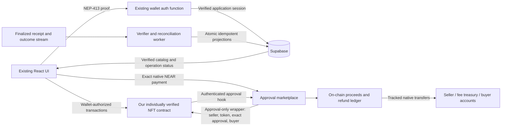
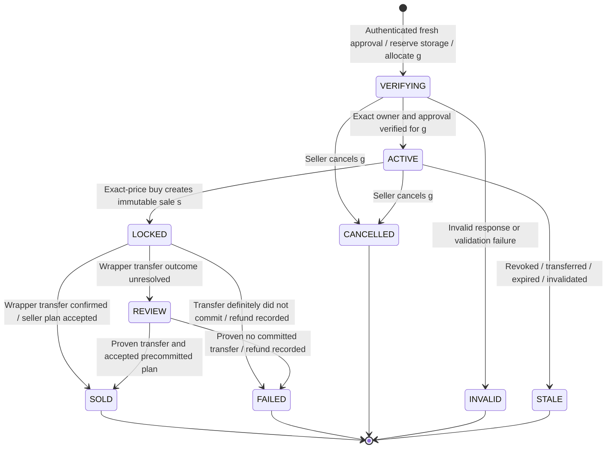
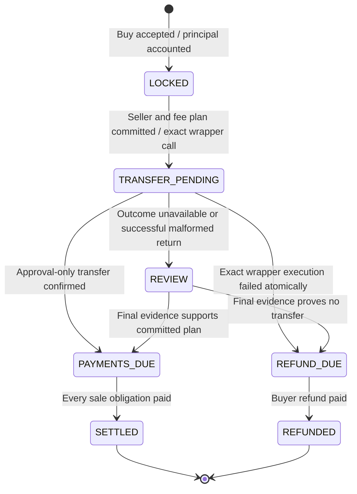
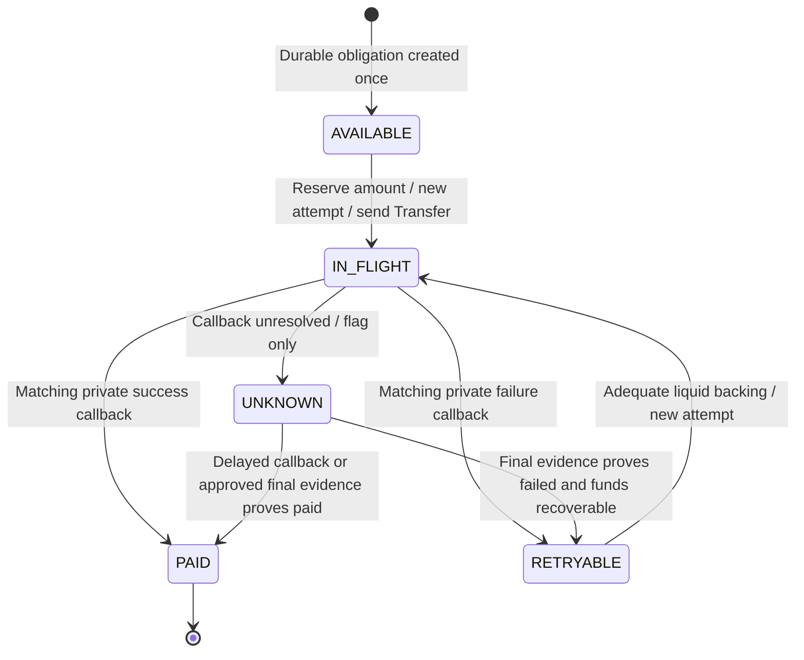

# NEAR NFT marketplace: architecture review and implementation plan

Review date: 2026-10-31. Status: proposed architecture for review; implementation is not authorized by this document.

**V1 decision:** build an approval-based, fixed-price marketplace for native NEAR, admitting only our own individually verified NFT contract, with no royalties. Every purchase must use an approval-only transfer wrapper in that NFT contract that atomically checks the configured marketplace caller, expected seller/current owner, and exact active approval ID before transferring. Ordinary SDK `nft_transfer` is insufficient for this sale authorization. Preserve the current React design and NEP-413 authentication. Use immutable purchase records, a durable on-chain payment ledger, and a trusted finalized-receipt indexer feeding Supabase. Trading stays disabled; this document does not authorize implementation, deployment, migrations, or enabling either trading gate.

This continuation revises only `MARKETPLACE_ARCHITECTURE_PLAN.md`, which was already untracked alongside substantial existing working-tree changes. No application/contract source, tests, migrations, environment settings, dependencies, or frontend files are changed. No transactions, deployments, migrations, or trading activation are authorized. Public NEAR RPC observations and executed checks recorded below are retained from the earlier review; they were not rerun in this documentation-only continuation. The SDK authorization branch and current NFT delegation were inspected locally for this revision.

Throughout this document, **verified** means observed in the working tree, executed locally, or returned by the specified public RPC. **Proposed** describes future behavior, including every new marketplace method and event. **Unverified** identifies evidence still needed. Existing documentation was treated as background, not deployment evidence.

**1. Repository findings — verified**

The reviewed working tree is based on Git commit `8ab06c804c7403314bbec6ce60069d4aef6a9e3f`, with substantial pre-existing modified, deleted, and untracked files. That commit alone does not identify the reviewed implementation. Preserve these changes and create a reviewed source snapshot before a future reproducible deployment.

| Area and evidence | Finding | Architectural consequence |
| --- | --- | --- |
| `frontend/Nft/src/App.jsx`, `components/`, `pages/` | React/Vite application with auth, dashboard, marketplace, wallet, account, creation, game, and NFT detail routes; existing layout, cards, forms, animations, and wallet modal | Retain routes, layout, styling, and components. Integrate through services, hooks, data mappings, and existing status/error areas. |
| `src/config/marketplace.js` | `LISTING_ACTIONS_ENABLED` and `PURCHASES_ENABLED` are literal `false`; creation/detail handlers also check them | Retain these gates. Wallet connection or configured addresses must not open trading. Add contract-side pause/admission controls later. |
| `src/components/protectedRoute.jsx` | Unauthenticated users can browse pages with a preview banner; it does not enforce a hard route boundary | This is an intentional display mode. Contract authorization and database grants/RLS remain the security boundaries. |
| `src/context/walletContext.jsx`, `src/services/auth.js` | Wallet Selector; verified identity separated from wallet selection; login serialization, aborts, account-switch handling, session comparison and verification expiry | Preserve this functioning structure. An already broadcast purchase must remain attributable to its original buyer after a wallet switch. |
| `supabase/functions/near-wallet-auth/{handler,nep413}.mjs` | Single-use challenges, request binding, origin/network/project binding, Ed25519 NEP-413 verification, finalized FullAccess-key lookup, server provisioning, second proof bound to actual Supabase user/session IDs | Retain wallet-only authentication. This verifies login authority, not NFT ownership or transaction settlement. |
| Same auth handler | Uses a random internal `@wallet.invalid` Auth identity and server-consumed Admin magic-link exchange; no user password or delivered email login | This is a Supabase session bridge behind wallet proof. Do not replace it with user-facing email/password authentication. Public/anonymous signup and bypass login paths still require deployment verification. |
| `src/lib/near/contract.js:4` | Real Wallet Selector payload for the source-defined `nft_mint(token_id, token_owner_id, token_metadata)` | Helper exists but is not wired into creation. Fixed 0.00125 NEAR deposit is not a proven sufficient storage quote. |
| `src/lib/near/contract.js:28` | Calls assumed `list_nft` directly on the marketplace with a fixed 0.01 NEAR deposit; no NFT approval flow | Dormant placeholder interface. Replace after the new ABI exists; do not deploy a contract merely to match this assumption. |
| `src/lib/near/contract.js:54`, `src/pages/nftDetails.jsx:113` | Dormant purchase calls assumed `buy_nft`; handler supplies database `listing.id`, ignores returned execution details, and reloads after two seconds | A database UUID is not a chain sale identity. Wallet return/timeout does not establish success. Replace with typed, verified listing identity and transaction tracking. |
| `src/lib/near/contract.js:78` | Standard one-yocto `nft_transfer` helper, limited to configured NFT contract; unused in current UI | Retain or generalize only when needed. A direct NFT transfer is not a paid marketplace purchase. |
| `src/services/marketService.js:86,165` | Listing/cancellation write directly to Supabase, using profile ownership and client checks | These paths do not perform blockchain operations; prepared DB privileges deny them. Replace their internals, not the UI. Client duplicate checks are not concurrency control. |
| `src/pages/createNft.jsx:316`, `src/services/nftService.js:226` | Uploads artwork and inserts an unminted catalog row; displays “NFT created successfully” | Current creation is a catalog draft, not minting. Later distinguish “Draft saved”, “Mint submitted”, and verified “Minted” within the existing interface. |
| `src/services/marketService.js:24`, `src/pages/nftDetails.jsx:41`, `src/pages/dashboard.jsx` | Preview fixtures substitute for errors or empty results; details can substitute the first preview NFT under the requested ID | No fabricated purchase fallback remains, but catalog previews can mask failures and identities. Make preview an explicit mode and never substitute another token in a live detail route. |
| `src/lib/near/utils.js`, service SELECT constants | Validated decimal strings, BigInt conversion, u128 bounds, `price::text` before JSON serialization | Preserve these protections. Extend them to every chain amount, sequence and approval ID; never repair already-rounded JSON numbers. |
| `src/context/walletContext.jsx:43` | Balance is converted to JavaScript Number for display | Keep it display-only. It is neither exact nor a spendable-balance authorization check. |
| `src/config/near.js`, wallet provider, auth handler | Config defines custom RPC/wallet/helper URLs, but Wallet Selector receives only the network name and the auth function selects its own RPC. Default URLs remain Testnet even if only network ID changes; network hint is hard-coded Testnet | Establish one validated deployment/network manifest and explicit per-environment providers. Do not infer network solely from account suffixes. |
| `contracts/nft/src/lib.rs` | Rust NFT contract delegates core, approval and enumeration to `near-contract-standards`; metadata support included; no approval-only sale wrapper or configured marketplace field exists | V1 requires those additions and their independent verification before admission. Existing standard transfers alone cannot enforce the marketplace seller/approval invariant. |
| `contracts/nft/src/lib.rs:57` | Minting is permissionless, accepts an arbitrary recipient, and does not check the configured contract owner | This may suit a public minting platform, but does not enforce a curated collection or authenticate a Supabase creator. Document the mint policy before changing it. |
| Same NFT contract | No `nft_payout` or `nft_transfer_payout`; no marketplace receiver, sales, proceeds or refund ledger | It currently has no NEP-199 royalty implementation. Do not invent royalties from frontend fields or assume payout methods exist. |
| `supabase/migrations/20261029000100_near_marketplace.sql` | Profiles, catalog NFTs, UUID ownership, listings, likes, rewards, triggers, grants/RLS, append-only browser artwork uploads | Useful protective foundation, but insufficient chain identity and settlement model. These are prepared bootstrap migrations, not evidence of live enforcement. |
| Same migration, `reconcile_nft_purchase` | Service-only SQL sink checks matching identities/price and updates listing/ownership atomically; browser `complete_nft_purchase` deliberately rejects | Preserve the security boundary. The RPC is not a chain verifier, requires registered profiles, and assumes one purchase per network/transaction. Replace with richer idempotent reconciliation. |
| `supabase/migrations/20261029000200_near_wallet_auth.sql` | Private challenges/session grants; service-only auth RPCs; session-bound writes, serialized attachment/revocation | Preserve NEP-413 and session constraints. Verify the real Auth schema and concurrency before deployment. |
| `supabase/NEAR_WALLET_AUTH.md` | Trusted ingress rate limiting and live Auth/RLS testing explicitly remain outstanding | Authentication deployment work remains part of readiness. The database issuance quota does not stop a distributed attacker from consuming the global allowance. |
| `src/services/nftService.js`, image policies | Safe retained uploads after ambiguous catalog creation/deletion; unused `deleteNFTImage` helper is incompatible with browser policies | Preserve append-only browser storage. A backend retention/cleanup job must also inspect on-chain media references. |
| Repository inventory | NFT package and five JavaScript test files exist; no marketplace package, marketplace ABI, reconciliation worker, deployment manifest, or CI deployment workflow found | These are new implementation deliverables. The unrelated `soroban-cost-estimator/` tree is outside this marketplace review. |

Duplicated/incomplete integration includes image validation in both the creation page and service, session reads scattered across services, direct catalog/listing queries in pages, network selection in three places, and approval/listing helpers that are not connected to each other. Consolidate only the transaction/data boundaries needed for correctness; broad component rewrites are unnecessary.

The first migration currently assigns `nft_ownership.owner_id = creator_id` after every catalog insert. That is application ownership of an unminted draft, not verified chain ownership. It must never be promoted to on-chain ownership evidence. Its artwork trigger also requires the configured Supabase upload prefix, which cannot represent arbitrary imported NFT media as written. Preserve draft protections and introduce a separate chain-token representation.

Public configuration and deployment observations:

| Observation | Evidence and limit |
| --- | --- |
| `.env` network is `testnet`; RPC is `https://rpc.testnet.near.org`; NFT is `nft-preview.testnet`; marketplace is `market-preview.testnet` | Extracted only public NEAR configuration; credential values were not printed. |
| NFT account lookup returned `UNKNOWN_ACCOUNT` | `query/view_account`, `finality: final`, block height `275518171`, block hash `CQ6yGWkN6PZRGWwrAgtCkYNYJnoexHdwJHjcgPEGZ4AM`. |
| Marketplace account lookup returned `UNKNOWN_ACCOUNT` | Same method/finality, block height `275518170`, block hash `9aMrB1iqWG89KkyfN9gMVZGmRi5rG2UHsQ8MN8zop2vg`. |
| No current deployed marketplace established | These are point-in-time responses from the configured provider, not an independently verified full-node audit or a permanent assertion about those accounts. No deployed code/ABI can be matched from these responses. |
| Supabase deployment state remains unverified | No live Supabase project was inspected. Confirm migration history, schema, grants, secrets configuration, Auth settings and ingress before applying anything. |

Installed/locked versions examined: Wallet Selector core 8.10.2, `near-api-js` 4.0.4, Supabase JS 2.114.0, React 19.2.8, Vite 8.2.2; NFT Cargo lock selects SDK/standards 5.30.0. Package ranges are broader than some locked versions. Pin the reviewed versions/toolchain for deployment rather than upgrading incidentally during this work.

**2. Standards and SDK findings — authoritative sources**

| Standard/API | Verified semantics and consequence |
| --- | --- |
| [NEP-171](https://github.com/near/NEPs/blob/master/neps/nep-0171.md) | `nft_transfer` transfers ownership and clears approvals, with exactly one yoctoNEAR. `nft_transfer_call` introduces receiver/resolver execution; its initial transfer is not a terminal custody result. V1 uses synchronous transfer inside our approval-only wrapper, never ordinary `nft_transfer` as the purchase entry point. |
| [NEP-178](https://github.com/near/NEPs/blob/master/neps/nep-0178.md) | Approval is token-specific, owner-authorized and carries a changing approval ID. `msg` triggers `nft_on_approve`; that callback can fail while approval remains granted. Revocation does not guarantee a marketplace notification. V1 must enforce both current seller ownership and the exact active approval at transfer execution, even if the marketplace owns the token. |
| Local `near-contract-standards` 5.30.0, `non_fungible_token/core/core_impl.rs`, `internal_transfer` | Approval lookup and optional ID comparison occur only in `if sender_id != &owner_id`; the owner branch skips both. Passing `Some(old_id)` to standard `nft_transfer` does not constrain an owner-caller. This is valid owner-transfer behavior, but unsafe as a sale-authorization guard. |
| [NEP-199](https://github.com/near/NEPs/blob/master/neps/nep-0199.md) — future only | Optional payout interfaces and their failure guidance are recorded in section 11. V1 implements neither royalty quotes nor royalty transfer/payout paths. |
| [NEP-413](https://github.com/near/NEPs/blob/master/neps/nep-0413.md) | Domain-tagged, hashed Borsh message signing with nonce/recipient and FullAccess authority is distinct from transaction signing. Retain the current verification/session bridge. |
| [NEAR cross-contract execution](https://docs.near.org/smart-contracts/anatomy/crosscontract) | Calls and callbacks execute independently. A callback failure cannot roll back an NFT already transferred in another receipt. Cancellation and upgrades can interleave unless the contract prevents them. |
| [Private callbacks](https://docs.near.org/smart-contracts/security/cross-contract-calls/callbacks) | Internal callbacks need `#[private]`, exact operation context and expected promise count. `nft_on_approve` is an external NFT hook and must instead authenticate the NFT predecessor. |
| [SDK bounded result API](https://docs.rs/near-sdk/latest/near_sdk/env/fn.promise_result_checked.html) | The page identifies version 5.30.0, matching locally inspected crate source. Use `env::promise_result_checked(index, max_len)` and handle `Failed` separately from `TooLong`. The older unbounded `promise_result` is deprecated. Oversized successful return data is not proof of transfer failure. |
| [SDK Promise API](https://docs.rs/near-sdk/latest/near_sdk/struct.Promise.html) | Use `NearToken`, `Gas`, typed external interfaces and `.then(...)`; explicitly construct/return or detach intended promises. Reserve callback gas rather than forwarding the entire transaction budget. Avoid relying on newer optional host features without network verification. |
| [Wallet Selector API](https://github.com/near/wallet-selector/blob/main/packages/core/docs/api/wallet.md) | Browser signing may return `void` because of redirect. Installed 8.10.2 transaction types use string gas/deposit fields; current online examples may use newer helpers. Implement against the locked adapter, not copied latest-version examples. |
| [NEAR transaction RPC](https://docs.near.org/api/rpc/transactions) | Request `wait_until: FINAL` for settlement evidence, including refund receipts. Latest docs name `tx_status` for nearcore 2.14+ and `EXPERIMENTAL_tx_status` for older nodes. Installed provider's `txStatusReceipts(..., 'FINAL')` uses the experimental method. Capability-test deployed providers; finality alone does not guarantee a complete returned receipt list. |
| [NEP-297 events](https://github.com/near/NEPs/blob/master/neps/nep-0297.md), [NFT events](https://github.com/near/NEPs/blob/master/neps/nep-0256.md) | Use versioned structured event logs, authenticating the executing contract and successful receipt. Marketplace events have their own standard name; they must not impersonate NFT events. |

There is no universal trustworthy “supports standard” response. ABI probing and successful view calls cannot prove honest transfer behavior. Admission needs source/code identity, upgrade analysis, adversarial fixtures and compatibility tests. A malicious NFT contract can lie consistently about owner, approval, payouts and events; neither marketplace model can make it honest.

**Security finding: direct custody must not become seller authorization.** Seller S creates listing generation g with approval a, then transfers the token directly to the marketplace; the transfer clears approvals. A stale purchase that calls ordinary `nft_transfer(..., Some(a))` can still deliver it because the marketplace is now the owner. The same race exists after listing verification and before the purchase transfer receipt. A purchase lock, frontend check, refreshed view, or supplied approval argument cannot close this gap. V1 requires the NFT-side wrapper below to reject because S is no longer the owner and approval a is absent. Marketplace custody, an NFT transfer event, a deposit message, and an old listing never substitute for the seller's exact live approval.

**3. Recommended architecture and custody comparison — proposed**



Supabase stores application content and projections; it does not authorize transfer or decide that payment occurred. Users can interact directly with the contract, so the indexer must discover operations independently of browser submissions and registered profiles.

| Dimension | Approval-based | Custodial marketplace |
| --- | --- | --- |
| NFT owner before purchase | Seller | Marketplace account after completed deposit resolution |
| Listing flow | Seller prepays marketplace storage and approves the marketplace on the NFT | Seller transfers into custody, normally through `nft_transfer_call`; listing activates only after custody is resolved |
| Seller flexibility | May transfer/revoke externally; listing can become stale | Cannot transfer externally while in custody; must request a return |
| Purchase reliability | Revocation or external sale can cause transfer failure; needs refund ledger | Fewer external-owner races after deposit; outbound transfer and payment can still fail |
| Cancellation | Stop marketplace listing; seller separately revokes approval | Requires an asynchronous NFT return with its own failure/recovery process |
| Compatibility | V1 requires our verified NFT plus the mandatory seller/approval wrapper; standards support alone is insufficient | Future only: requires a separate deposit-authorization and return design |
| Royalty owner semantics (future only) | Seller remains owner until transfer | A payout method may see the marketplace as owner; adapter must preserve the beneficial seller, not pay custody as if it were the seller |
| Risk concentration | Marketplace temporarily holds payment and has scoped transfer authority | Marketplace holds both deposited NFTs and payments; additional custody inventory and return liabilities |
| Fit here | Existing NFT already implements approvals; matches requested seller-wallet UX | Adds custody and return flows without evidence that the product needs them |

Recommend approval-based. Custody does not solve malicious contracts, malformed payouts, lost callbacks, or duplicate native transfers. Its main benefit is removing seller revocation races after deposit, at the cost of materially more asset custody and recovery work.

V1 scope is fixed: native NEAR, fixed prices, our own individually verified NFT contract only, no royalties, one token per purchase method call, and buyer receives to their paying account. Preserve the existing frontend design and NEP-413 wallet authentication. Supabase is a projection; finalized blockchain receipts are authoritative. Both existing trading gates remain `false`. The schema still supports multiple sale events in a root transaction because users can batch calls outside the UI.

There is one v1 transfer mode: the approval-only wrapper on our NFT contract. Pin its account, reviewed code and ABI, and its configured marketplace account to the deployment manifest. Our current source is a candidate, not an admitted deployment; ownership by our team does not replace verification. No generic standard-transfer fallback, royalty adapter, or configurable third-party admission path belongs in v1.

For the first production version, require immutable NFT code and marketplace binding: no deploy-capable keys, mutable global-code indirection, or unreviewed upgrade/configuration entry point. Off-chain code-hash polling cannot close an upgrade race between verification and transfer. The marketplace likewise should have no unrestricted deploy key after release; prefer a new audited deployment for incompatible upgrades. Operational account/key evidence is still required. Third-party contracts, royalties, custody-based sales, upgradeable implementations, auctions/bids, FT payments, carts, gifting and cross-network execution are future features, separately scoped in section 11.

**4. On-chain data and method specification — proposed, not existing ABI**

All method names below are design proposals. Generate and test the actual ABI during implementation before changing the wallet adapter.

**Required v1 NFT entry point: `marketplace_transfer_approved(expected_seller_id, token_id, approval_id, receiver_id)`**

This method belongs in our NFT contract. `expected_seller_id`, `token_id`, and `approval_id` are mandatory; the approval ID is exact, never optional, inferred, or replaced with the newest ID. `receiver_id` is the immutable sale's paying buyer. The NFT stores a single configured marketplace account at initialization; v1 exposes no setter that can redirect this authority. Its binding and code must be individually verified before the marketplace admits it.

In one synchronous NFT receipt, before changing ownership, approvals, or emitting a successful transfer event, the wrapper must:

1. Require exactly one yoctoNEAR and `predecessor_account_id == configured_marketplace_id`. Root `signer_account_id` is not authorization; a forwarded call from another contract must fail.
2. Require an existing token and `owner_by_id[token_id] == expected_seller_id`. Reject `expected_seller_id == configured_marketplace_id`: a token held by the marketplace is not a v1 sale inventory item. Reject receiver equal to seller or marketplace.
3. Read the token's current approval map directly in the same receipt. Require a present entry for the configured marketplace and equality with the supplied approval ID. Missing approval support/map/entry, revoked approval, and any ID mismatch must fail. This check is unconditional; there is no owner-caller exception.
4. Only after all checks succeed, perform the synchronous standard ownership/enumeration update, clear all token approvals, and emit the standard NFT transfer event. The wrapper may delegate to the reviewed SDK transfer implementation after these checks; delegating first, or relying on its optional-ID branch alone, is forbidden. Validation failure must leave token owner and approvals unchanged.
5. Return the bounded success value defined by the reviewed ABI from this same receipt. Do not use `nft_transfer_call`, return a later promise, or perform asynchronous owner/approval validation. Any separate storage-refund outcome must not redefine whether this ownership transfer committed.

The marketplace calls this wrapper for every purchase using only immutable sale fields. It never retries via `nft_transfer`, `nft_transfer_call`, a payout method, or an owner-only administrative path. Recovery cannot change the expected seller, adopt a newer approval ID, or turn custody into a sale. Ordinary standard NFT methods may remain for owner-directed transfers; they are not marketplace purchase entry points. Independently authenticate and constrain any eventual non-sale deposit return as described in section 7.

**Marketplace-owned asset authority.** V1 must expose no generic NFT-transfer forwarding, arbitrary contract-call/proxy/batch method, caller-selected method name/arguments/deposit, or administrative transfer escape hatch. This prohibition applies to guardians, governance, recovery accounts and keepers as well as ordinary callers. Enumerate and audit every outbound call site: sale delivery uses only `marketplace_transfer_approved`; unsolicited-deposit return uses only the separately authorized return operation below; views and fixed-recipient native payments use their dedicated methods. No owner-only shortcut may transfer an NFT to complete, retry or recover a purchase. Require immutable code and no transaction-signing access keys on the NFT or marketplace accounts after bootstrap, including function-call keys that could sign external NFT calls as the marketplace. Removing only deploy-capable/FullAccess keys is insufficient if another key can bypass contract methods using the marketplace's owner identity. Verify both complete access-key lists and all contract-controlled call paths before admission; external role accounts retain only their separately scoped authority.

**Permanent token-ID non-reuse — recommended v1 policy.** A token ID may be minted successfully at most once for a given `(network, NFT contract account)`, across all owners and for the entire contract lifetime. At mint, atomically require absence from an `EverMinted` registry and insert the exact opaque token ID before completing ownership/metadata creation; failure rolls back both. The registry is independent of live ownership/enumeration. A live mint reserves permanent identity; burning changes it to a retained `BURNED` tombstone, never to an unused ID. Caller, recipient, metadata, a new approval sequence or a later deployment version cannot authorize reminting that ID. Reject duplicate/remint requests without changing any state.

Recommend no public burn entry point for the initial release. If burn is subsequently authorized, it must be owner-authorized and atomic, remove live ownership/enumeration/approvals, emit a burn event and retain the permanent ID tombstone and approval-counter high-water mark. `nft_token` then reports no live token; all transfers/approvals for it fail. Marketplace token slots, generation tombstones, sales, claims and historical ownership remain. A burn before wrapper execution causes a failed sale/full principal refund; a burn by the buyer after successful delivery does not undo that sale or its proceeds. Late hooks, transfer-call resolvers, recovery and history pruning must never recreate a burned token or its approvals.

Reserve and charge permanent registry/tombstone storage at the original mint; a later burn cannot refund this retained stake. If any prior state is imported, establish the complete historical minted-ID set, including burns, before admission; incomplete history blocks admission rather than allowing reuse. Any future migration must preserve these records and monotonic counters. A different NFT account creates a different identity namespace and needs a future admission decision; it cannot silently replace the old token identity in Supabase. This policy is required even when v1 exposes no burn method, and its approval and implementation remain outstanding.

On-chain records:

| Record | Required contents/invariant |
| --- | --- |
| `MarketConfig` | Configured network/deployment domain and artifact environment, schema version, pause/financial-hold state, constrained fee policy and treasury verification/acknowledgement, our verified NFT binding, three immutable recovery members/threshold two, recovery delay/policy, approved reserve/freshness parameters and named operational authorities; non-reused counters for generations, sales, returns, cases, dispute epochs and test sessions. Missing approved values leave readiness false. V1 cannot add third-party NFTs; network correctness also requires external verification. |
| `TokenSlot` | Borsh-encoded `(nft_contract_id, token_id)` key, generation high-water mark, highest consumed approval ID, current listing reference and mutually exclusive sale/return lock. Retain replay protection after burn. Never concatenate ambiguous user strings to construct a key. |
| NFT `EverMinted` | Permanent exact token-ID registry with live/burned status and retained counter high-water mark; initialized by successful mint, never deleted or reset by burn, transfer, migration or cleanup. |
| `ListingGeneration` | Generation unique across this marketplace deployment, also increasing for each token; NFT identity, seller AccountId, exact approval ID, price, expiry, fee/policy snapshot, request correlation, state, verification attempt, optional sale ID, reserved storage. Identity and terms are immutable. |
| `Sale` | Globally unique non-reused sale ID, listing generation, NFT/approval/seller/buyer snapshots, attached price, fee, approval-only wrapper version, committed seller/fee plan/hash, exact wrapper call hash, transfer operation/attempt, transfer outcome, settlement state and remaining obligations. No royalty mode in v1. |
| `PaymentObligation` | Unique claim ID, source sale/generation or storage withdrawal ID, beneficiary AccountId, role, exact amount, state, attempt counter and current operation hash. Recipient and amount are not caller-supplied on retry. |
| `OperationAttempt` | Non-reused operation ID, kind, source identity, nonce, immutable call/transfer hash, state and recovery evidence reference. Terminal attempts cannot become pending again. |
| `DepositReturn` | Unique return ID and deposit receipt/event identity, our NFT/token, proven prior owner/fixed recipient, recipient's request, provenance evidence hash, purpose-specific quorum authorization, exclusive token lock, attempt and return state. Separate from every sale and payment obligation. |
| `RecoveryCase` | Contract-derived typed source/current attempt and pre-state/version, immutable snapshot hash, at most three typed decision payloads/member votes, quorum time, dispute epoch/hold state, consumed status and permanent terminal digest. No caller-selected beneficiary, amount or external-call payload. |
| `StorageAccount` | Depositor's total, occupied bytes/stake, reservations, withdrawable balance and pending withdrawal. Sales never spend customer storage backing. |

Prices and balances are checked u128 yoctoNEAR. Marketplace view IDs/generations are decimal strings. Standard NFT approval arguments are serialized according to the admitted ABI, not blindly changed to quoted strings. NEP-171 describes JSON-safe approval numbers while the Rust SDK uses u64: v1 should reject approval IDs outside its explicitly tested safe range; keep backend decoding lossless regardless.

Proposed initial limits for benchmarking: token ID at most 1,024 UTF-8 bytes; listing message at most 4 KiB; wrapper result at most 4 KiB (tighten to the selected success ABI); token-view result at most 16 KiB; at most four separate payment dispatches in one keeper batch. V1 allocates only seller/fee or full buyer refund claims, with no payout-map input. Account IDs use the SDK validator. Reject data exceeding supported bounds rather than truncating identity. Gas and exact byte reservations must be measured against these limits before enabling a deployment; they are not verified cost estimates.

| Method | Caller/deposit | Preconditions, effects and result |
| --- | --- | --- |
| `new(config)` | Initializer, once | Validate roles, immutable fee cap, network/deployment domain and limits; initialize paused. No arbitrary external-call escape hatch. |
| `storage_deposit(account_id?)` | Any payer; attached storage funds | Credit the selected beneficiary's storage account; bound first-registration cost. Deposit is not listing proof. Return exact balance/reservations. Clearly state that sponsored funds belong to the credited account. |
| `fund_operating_reserve` | Sponsor/payer; explicit approved funding terms and attached contribution | Record purpose-bound operating capital separately from principal/customer credits. No automatic trading resume, claim reassignment or withdrawable credit for a contribution. Method stays unavailable until funding terms are approved. |
| `storage_balance_of`, `storage_balance_bounds`, `quote_listing_storage` | Views | Report current storage pricing and worst-case reserve requirements. Do not present a constant NFT approval deposit as a universal quote. |
| `storage_withdraw(amount)` | Storage beneficiary; exactly one yocto | Withdraw only unreserved balance. Create a tracked withdrawal obligation before sending; no unregister while live state, claims, attempts or retained bytes remain. |
| `nft_on_approve(token_id, owner_id, approval_id, msg)` | Our configured, verified NFT contract as predecessor; normally zero deposit | Validate bounded/versioned msg, price, expiry and expected fee terms; require seller's prepaid storage and owner != marketplace; reject consumed approval and conflicting live/in-flight generation. Consume the fresh approval ID and allocate a new generation in `VERIFYING`, then check `nft_token` and `nft_is_approved(token, marketplace, Some(exact_id))` through bounded calls. Return a promise/structured pending result. |
| `on_listing_verified(generation, verification_attempt)` | Private; exactly the expected results | Match stored current candidate, NFT/token/expected seller/exact approval and attempt; require seller != marketplace. `VERIFYING -> ACTIVE` only when actual owner is the seller and exact marketplace approval is present. False/malformed/unavailable -> terminal `INVALID`; seller reapproves with a new ID to retry. A cancelled/stale callback is a no-op. Custody alone can never activate a listing. |
| `cancel_listing(nft_contract_id, token_id, generation)` | Recorded seller as predecessor; exactly one yocto | Only `VERIFYING` or `ACTIVE`. Set `CANCELLED`, release eligible storage reservation, retain replay protection. Never cancel a locked purchase or alter an old sale. |
| `refresh_listing(nft_contract_id, token_id, generation)` | Any caller funds gas; bounded/rate-limited | Recheck exact owner/approval for a live generation; permit at most one refresh attempt at a time. This improves availability data; final transfer authorization remains decisive. |
| `on_listing_refreshed(generation, refresh_attempt)` | Private; expected query results | Only act on the same still-active generation and attempt. Conclusive invalidity -> `STALE`; a query error records unknown freshness without inventing revocation. Do not modify a locked sale, reactivate a terminal generation or overwrite a newer refresh result. |
| `buy(nft_contract_id, token_id, generation, expected_price_yocto)` | Buyer/paying predecessor; deposit exactly price | Require unpaused/our admitted NFT/current unexpired `ACTIVE` generation, matching price, sufficient reserves/gas, seller != marketplace, and buyer != seller/marketplace. Atomically lock token/listing and create immutable `Sale` before scheduling the wrapper with its seller, token, exact approval and buyer. Return sale reference/promise; not an assertion of completed payment. |
| `on_nft_transfer(sale_id, generation, operation_id, attempt)` | Private | Match the exact wrapper operation and read bounded raw promise result. Known failed synchronous wrapper receipt -> full buyer refund obligation, never a fallback transfer. Verified successful wrapper transfer -> committed seller/fee obligations. Successful malformed/mismatched result -> hold for recovery. Never infer buyer refund from a parse error. |
| `dispatch_payment(claim_id)` | Beneficiary or keeper, gas-funded; zero deposit | Only an available/retryable, sufficiently backed claim. Atomically reserve its whole amount, increment attempt, mark in flight, then schedule one native Transfer and private callback. Always pay stored beneficiary. |
| `on_payment(sale_id?, generation?, claim_id, attempt_id)` | Private | Validate exact source and attempt. Success -> paid; known failure -> retryable liability. No repeated transition/debit on duplicate or late callback. Storage withdrawals use their own immutable source ID. |
| `flag_stalled(operation_id)` | Any caller after policy interval | Mark/flag unresolved operation for review without unlocking, refunding, resending, or deciding it failed. Open a recovery case only after this classification; repeated flags cannot change its expected pre-state. An authentic delayed callback can still resolve the same attempt and obsolete the case. |
| `open_recovery_case(source)` | Any caller pays measured case storage; no outcome authority | Accept only `RecoverySourceV1`; derive source kind/ID, current attempt, pre-state/version, immutable terms and snapshot from stored state. One canonical case per typed source/attempt. Opening cannot choose a verdict, acquire an additional asset lock or overwrite a case. |
| `attest_recovery(case_id, decision)` | One of exactly three configured member predecessors; zero deposit | Parse full `RecoveryDecisionV1`, validate the domain/source/snapshot/verdict, compute its hash internally and record one immutable vote per member. No hash-only authorization. Two identical payloads authorize only section 7's transition after the configured delay and absent a dispute hold. |
| `execute_recovery(case_id)` | Anyone after matching 2-of-3 quorum and delay; zero deposit | Recheck case, current operation/attempt/pre-state and allowed transition; consume authorization once. No external NFT/payment send during outcome resolution. Deposit authorization is a separate case purpose, never sale recovery. |
| `hold_recovery(case_id, incident_hash)` | Configured pause guardian or any recovery member; zero deposit | Set a case-specific hold and increment a checked dispute epoch. Hold cannot alter votes, source, beneficiaries or liabilities; authentic callbacks remain enabled. |
| `confirm_recovery_release(case_id, epoch, decision_hash)` | Configured recovery members; zero deposit | Record a separate purpose-bound confirmation for the existing matching outcome decision in the current hold epoch. Two matching confirmations and a fresh full delay permit clearing that hold; no corrected verdict or new outcome vote is accepted. |
| `clear_recovery_hold(case_id, epoch)` | Anyone after matching release confirmations and delay | Clear only that current hold epoch; change no economic/source state and send nothing. Original recovery execution or approved return dispatch must still satisfy its own checks. A newer hold invalidates old confirmations. |
| `request_deposit_return(nft_contract_id, token_id, deposit_receipt_id)` | Claimed prior owner/return recipient as predecessor; measured storage funding only | Store a bounded untrusted claim, with no transfer authority, token lock or consumed deposit entitlement. A false first claim cannot block the genuine owner's request. Our NFT only; provenance/recipient require independent quorum verification. No alternate recipient or arbitrary transfer arguments. |
| `execute_deposit_return(return_id)` | Anyone funds gas after recipient request, distinct deposit quorum and delay | Recheck fixed recipient/provenance authorization and absence of conflicting operations; atomically acquire the token return lock and schedule only the dedicated NFT return entry point. Method accepts no transfer payload. See section 7. |
| `on_deposit_return(return_id, attempt_id)` | Private; one expected result | Success -> `RETURNED`; conclusive synchronous failure -> `RETURN_RETRYABLE`; missing/ambiguous result -> keep lock/`RETURN_UNKNOWN`. Bound and validate result; never change sale or payment state. |
| `get_listing`, `get_sale`, `get_claim`, `get_operation`, paginated views | Public views | Expose exact terms, attempts, transfer and settlement statuses, outstanding debt and version. Bound all pagination. |
| `pause`, `disable_nft_contract` | Limited guardian/governance | Stop new risk immediately. Existing callbacks, fixed-recipient claims/refunds and cancellations remain possible. Pausing must not strand legitimate debt. |
| `clear_financial_hold(health_report_hash)` | Explicitly approved reserve/resume authority | Require reconciled ledger, restored protected backing and configured buffers; record independently checked health evidence. Clears only the financial latch, never a trading pause, case dispute or immutable liability. Role identity/policy is an approval input. |
| `schedule_fee_policy`, `activate_fee_policy` | Named fee governance schedules; anyone activates after the immutable positive delay | Validate section 6 invariants before scheduling and activation. Bind exact next policy/version/hash and effective time; replace/cancel a pending proposal only through governance, with a replacement restarting the full delay. Apply solely to new generations; never rewrite existing listing/sale/claim terms. |
| `acknowledge_treasury_policy(policy_hash)` | Exact proposed treasury predecessor; zero deposit | Acknowledge the candidate policy/deployment and timestamp it. Initialization/replacement readiness requires this plus current, recorded external verification; it grants no authority over sale terms. |
| `record_treasury_verification(policy_hash, evidence)` | Designated, explicitly approved fee-policy reviewer; zero deposit | Store bounded network/account/control evidence coordinates and digest for the exact candidate. Contract timestamps submission and enforces hash/age requirements; the reviewer attests historical truth. No vote from recovery accounts substitutes for this role. |
| `activate_test_session(session)` | Approved test release authority; test-only artifact | Enforce section 10's immutable environment, exact manifest/domain, readiness, finite limits/expiry and tester/token allowlists; atomically record the session and clear only the test trading pause. Never clear financial/dispute holds. Production artifacts have no usable test activation method. |

`nft_on_approve` is authenticated by its predecessor and independently checked state, not by root `signer_account_id` or a browser-supplied NFT address. Buyer/seller authorization uses the immediate payer/owner; the worker must not assume the root signer is always the economic actor if contract-account callers are admitted. The initial wallet adapter uses direct transactions and an explicit signer ID.

Ownership/approval queries are observations, not an atomic lock across contracts, even when issued in parallel. An active approval listing may become stale immediately after verification. Safety relies on the NFT wrapper atomically enforcing expected seller ownership and the exact active marketplace approval at the transfer receipt. The standard SDK's approval argument alone does not provide this guarantee when the marketplace has become the owner.

`msg` should contain a schema version, exact price, expiry, expected fee policy and correlation nonce, all bounded. Correlation nonces aid UX; approval ID and generation enforce authorization/replay safety. V1 price changes require cancelling and reapproving to create a new generation, with refreshed storage funding. Do not mutate the price of an in-flight or existing generation.

Keep a funded high-water/tombstone record after cancellation/cleanup so a late approval hook cannot recreate a retired approval. A pending approval hook that has not reached the marketplace cannot yet be cancelled by generation: the seller can revoke at the NFT and then inspect marketplace state. UI must not claim cancellation until an actual cancellation/revocation result is verified. Correct approval checking prevents a later purchase using the revoked ID.

Revocation, re-approval and interleaving rules for v1:

- `nft_revoke`/`nft_revoke_all` may leave a cached listing `ACTIVE` until refresh/indexing catches up. If revocation commits before the wrapper executes, the wrapper fails without delivery and the accepted sale records one full buyer refund. If the wrapper commits first, the authorized sale stands; a later revocation cannot undo it. Report the actual receipt order.
- Re-approval replaces a with a new ID b, including when no listing `msg` is supplied. A sale bound to a must fail once b is current; never substitute b into g or its sale. Re-approval alone does not authorize new price terms. Retire/cancel the old live generation and obtain a fresh authenticated approval hook with versioned terms for a strictly newer generation. If a hook was rejected while a token was locked, it is not queued for automatic activation; after resolution the seller must approve again with a fresh ID and hook.
- Terminal generations and consumed approval IDs never reactivate. Approval/generation counters must not wrap or reset across transfer-away/transfer-back, cancellation, cleanup, or recovery; reject exhaustion. Delayed verification/refresh/hooks cannot overwrite a newer generation or unlock another sale. Validate any SDK transfer-call resolver restoration of approval state against these replay rules in sandbox tests.
- Cancellation before `buy` locks retires only the identified generation; cancellation after lock rejects. Cancellation does not revoke the NFT approval. A new listing still needs a new approval ID; the old approval cannot resurrect a cancelled generation. A newer owner or re-approved seller cannot alter an unresolved sale's recorded seller, buyer, or approval.
- A direct transfer or mint into marketplace ownership grants no listing or purchase authorization, before activation, while active, or after lock. Refresh may mark the generation stale; even without refresh, the wrapper rejects the custody case. Returning a quarantined deposit through non-sale recovery never revives its old listing: fresh seller approval and a new generation are required. A rejected transfer-call's automatic resolver is a separate lifecycle; its approval restoration must never reactivate a terminal generation.

**5. Listing, purchase and payment state diagrams — proposed**



Terminal generations never reactivate. A new listing uses a fresh approval ID and strictly new generation. A known failed sale may release its token lock after recording the buyer refund liability; the refund may still be unpaid. A sold token may later have a new owner's listing while old proceeds remain unpaid. Old callbacks must therefore operate on their immutable sale/claim, not the token's current listing. `REVIEW` retains the transfer lock until resolved.



Transfer outcome and settlement are also stored separately: a conclusively delivered NFT can have a settlement review or unpaid proceeds. The indexer must project actual ownership even while money is held, without claiming settlement completed. Marketplace custody from an unrelated direct deposit is an ownership observation, never a successful sale transition.



No path from `UNKNOWN` to another send exists without resolution. A timeout is not a receipt failure. No path from seller/fee debt to buyer refund exists merely because a recipient cannot receive payment.

**6. Transaction lifecycle and accounting — proposed**

Prerequisite: approved deployment/admission policy and enough seller-funded marketplace storage, including worst-case callback, claim, retry and retained-history costs. NFT approval storage is paid separately to the NFT contract; it is not forwarded to the marketplace.

1. **Seller approves.** Existing listing form obtains finalized token identity/owner and marketplace terms, then submits `nft_approve` to the actual NFT contract with marketplace account and versioned listing message. Persist only an unverified local operation intent at this point.
2. **Marketplace verifies and records.** The authenticated hook from our NFT consumes a fresh approval identity and creates generation `g` in `VERIFYING`. Exact seller ownership (seller != marketplace) and exact active marketplace approval checks activate it. These observations are provisional; the wrapper repeats the checks atomically at transfer. Callback failure does not revoke the original NFT approval; the UI explains the verified result and recovery/reapproval action. No database-only or direct-deposit listing is created.
3. **Buyer authorizes payment.** Read the live listing, check configured network/market/NFT/token/generation/price and selected account, then sign `buy` with exactly the integer price. Refreshing a quote helps UX, but the contract's equality checks handle races.
4. **Marketplace locks.** In one receipt, validate all local preconditions, charge/reserve storage, allocate non-reused sale ID `s`, snapshot identities/terms, and move the listing to `LOCKED`. Concurrent buyers and cancellation cannot acquire the same generation.
5. **Marketplace initiates transfer.** Commit the seller/fee plan, then call only `marketplace_transfer_approved` on our pinned NFT with the sale's expected seller, token, exact approval ID, and buyer. Attach one yoctoNEAR from the explicit operating reserve; principal stays in the marketplace. The wrapper checks caller, current seller ownership and exact active approval in its own synchronous receipt before transferring. No royalty quote or standard-transfer fallback is issued.
6. **Marketplace validates the outcome.** Private callback matches `s/g/operation/attempt`, exact wrapper call, expected promise count and bounded result. A successful audited synchronous wrapper receipt is different from a failed receipt, oversized return, invalid JSON, or an unexpected returned promise chain. Unknown cases retain principal and a review record. Marketplace ownership or a subsequent owner view cannot establish delivery or approval at execution.
7. **Marketplace distributes.** Validated wrapper delivery converts escrow once into immutable seller/fee obligations. A keeper or claimant calls bounded dispatch methods, which send native NEAR and record each result. Gas for later dispatch transactions is explicit and operationally funded. Credited debt is not described as paid cash.
8. **Failures become recoverable debt.** A definitely failed wrapper, including seller mismatch, direct custody, missing/revoked approval or replacement approval, produces one buyer refund claim for the entire purchase principal and retires the failed generation. Never pay the seller or treasury for that failed sale. Failed seller/fee/refund native transfers remain retryable claims. Buyer transaction gas and NFT/storage transaction costs are separate from refundable price.
9. **Trusted worker verifies.** Discover receipt events independently; retrieve finalized transaction/receipt graph, authentic executing accounts and contract state/history. Validate the actual outcome for every operation and payment attempt.
10. **Supabase reconciles.** Atomically record evidence, identities, listing generation, purchase, ownership transition, liabilities and projection checkpoint. Browser sees submitted, pending verification, delivered/payment pending, refunded or fully settled states according to evidence.

Minting uses a separate verified lifecycle: preserve artwork upload and draft creation; choose a collision-resistant, never-previously-minted token ID under the approved mint policy; submit the actual NFT `nft_mint` ABI from the selected wallet with sufficient measured storage funding, including permanent ID retention; then have the worker verify finalized mint receipt, token identity, actual recipient, creator attribution and expected metadata/media reference before linking the draft to `chain_tokens`. An ambiguous submission remains pending and is looked up before retrying the same identity; successful mint followed by burn is still a consumed ID. A catalog insert or wallet response never sets a minted flag by itself. Retained artwork is not deleted merely because a browser lost the mint response.

**Mint authorization is a separate product decision from contract admission.** Verifying our NFT contract's code does not make every artwork curated or verify its creator. The present source permits any caller and arbitrary recipient; choose and enforce one mint policy on chain before deployment, rather than treating the current behavior as approval of a product policy.

| Mint policy option | Required authorization and attribution | Consequences and outstanding choices |
| --- | --- | --- |
| Public self-service | Any caller may mint after ID, metadata/bounds and storage checks. Record actual predecessor as minter; recipient is the actual first owner. Recommend self-mint (`recipient == predecessor`) for v1; retaining the existing arbitrary-recipient behavior requires an explicit decision. | Supports the existing self-service creation intent, but invites spam, ID squatting and uncurated content; app moderation/rate limits cannot stop direct contract minting. Do not label every token curated or equate minter, copyright creator and owner. If third-party recipients are retained, account for unsolicited mints and separately verify creator attribution. |
| Curated issuance | Only an explicitly configured curator/minter allowlist or issuance governance can mint. Enforce membership on chain; a Supabase role or NEP-413 session alone is insufficient. Separate issuance keys from recovery, fee, guardian, treasury and database credentials. | Restricts supply/admission of artwork but introduces curator trust, review staffing, compromised-key and availability risks. Existing artwork creation can remain a draft/submission flow; mint status must report approval/issuance truthfully within the existing frontend design. Specify authorized minters, recipient consent and creator attestation; the issuing curator is not automatically the artwork creator. |

Under either option, enforce permanent token-ID non-reuse, bounded metadata, measured storage funding, no royalties, and reject the configured marketplace as initial recipient. No policy grants hidden seizure, arbitrary burn or remint authority. Public versus curated mode and any recipient/creator rules require explicit human approval. Prefer fixing the selected mode at initialization; any future switch or minter-administration power needs a separately reviewed policy and cannot change existing provenance or tombstones. The roadmap assumes a minimal self-mint or simple allowlist implementation, not a new moderation/curation product or frontend redesign.

**Mint execution, freshness and attribution are separate records.** A catalog draft or curated submission starts with no on-chain mint claim. Each submitted attempt records network/NFT, immutable token/metadata hash, minter, intended recipient, intent/consent references and transaction discovery data. The verifier sets an execution result independently from the projection's freshness:

| Display/verification state | Required evidence and permitted transition |
| --- | --- |
| `PENDING` | Wallet submission, redirect/unknown response, included-but-unfinalized receipt or incomplete final receipt graph. Remain pending on timeout; do not resubmit under a new token ID or infer ownership. A draft awaiting curator approval is labelled as a submission, not a pending blockchain mint. |
| `FINALIZED` | Successful finalized synchronous mint receipt from our verified NFT, matching token, first owner and metadata/intent; permanent ID recorded. Persist this historical fact even if the token later transfers or burns. A finalized mint whose content/recipient differs is recorded as an actual chain event with linkage quarantined, never falsely reported as a failed chain mint. |
| `STALE` | Freshness overlay when the indexer checkpoint, ownership observation or provider evidence is older than an approved bound, or dependencies conflict. Retain the last known execution result and its evidence height; do not turn a finalized mint into a failed one. Disable new trade eligibility from this projection until reconciliation restores freshness. A pending attempt can also have stale evidence. |
| `FAILED` | Proven wallet rejection before any broadcast, or the exact finalized mint action failed atomically. Distinguish submission failure from chain failure. Only that attempt failed; check all earlier pending attempts and the permanent registry before offering a retry. Failure of a later callback, database write or media fetch does not negate a successful mint. |

Model this as `execution_state = PENDING / FINALIZED / FAILED` plus `freshness = CURRENT / STALE / UNKNOWN` and `linkage = VERIFIED / QUARANTINED`, rather than overwriting one field for unrelated facts. Current owner/burn state is a separate ordered projection. Exact replay is idempotent; conflicting evidence is quarantined. The freshness bound and operator response target require approval and measured provider input; no duration is assumed. Finalized mint alone does not activate a listing or authorize a sale.

**Recipient consent.** Public self-mint uses the recipient's direct mint transaction as consent and requires `recipient == predecessor`. For curated issuance to a different account, recommend a one-use, expiring consent recorded on our NFT by that recipient before issuance: `accept_mint(intent_hash, expires_at)` authenticates the recipient predecessor and charges bounded storage. The mint receipt atomically validates/consumes that consent and the permanent-ID check; failed mint rolls back consumption. `MintIntentV1` binds schema/version, network/deployment/NFT, exact token ID, canonical metadata hash, recipient, authorized issuer or issuance-policy hash, claimed creator/assertion hash and a unique nonce. Hash its Borsh representation with a distinct `NEAR_MARKET_MINT_INTENT_V1` domain. The issuer cannot change metadata, recipient or attribution after consent; expired/revoked consent rejects. Self-mint needs no additional consent transaction. Recipient-consent expiry limits and any curated issuer-management policy need approval; if a different consent mechanism is chosen, it must offer equivalent on-chain binding before curated minting is enabled. A login proof, draft UUID or curator assertion cannot replace recipient consent.

**Creator attribution.** Always record the actual predecessor as minter/issuer and the actual recipient as first owner. A claimed creator is separate: mark it verified only when that account has explicitly attested the same mint-intent/content hash through a separately bound account-authorized assertion (recommended NFT-recorded `attest_creator(intent_hash)`, or an independently reviewed equivalent). Otherwise retain it as unverified/omitted; an allowlisted curator does not become the creator automatically. Account attestation proves who made the claim, not copyright ownership or authenticity of artwork. The existing NEP-413 login/session design stays unchanged and supplies no implicit authorship or mint consent. Record assertion/consent evidence with the finalized mint, and reject linking a draft whose attribution or content digest differs. The exact creator-assertion mechanism is an approval decision; verified-creator claims remain disabled until it is chosen and tested.

**Required fee configuration invariants; no economic values selected.** Initialization must explicitly supply `fee_bps`, immutable `max_fee_bps`, treasury AccountId, fee-governance account, positive immutable `fee_change_delay_ns` and initial policy version. Reject missing/defaulted values; a zero rate is allowed only when explicitly selected. Require integer `0 <= fee_bps <= max_fee_bps < 10,000`, so a positive-price sale always leaves a positive seller share. Validate treasury syntax and independently verify its existence/control on the correct network before release; it must differ from NFT/marketplace accounts and have keys separate from governance/recovery/guardian/writer roles. Syntactic AccountId validation alone does not prove a live treasury.

For integer price `0 < P <= u128::MAX`, calculate `F = floor(P × fee_bps / 10,000)` using a wider intermediate or overflow-safe quotient/remainder arithmetic, and seller share `B = P - F`. Require `0 <= F < P` and checked `B + F == P`. There are no minimum fees, surcharges, royalty deductions or fee rounding-up in v1; a computed zero fee creates no zero-value dispatch obligation. Storage and gas charges are disclosed separately and cannot be deducted silently from purchase principal. Merge overlapping seller/treasury beneficiaries for transfer accounting while preserving their role-level allocations.

Freeze policy version/hash, rate, treasury and fee formula in each listing generation and sale. The authenticated listing message must match the current policy when creating the generation; an existing generation continues under its committed policy even after a fee change. Only named fee governance may schedule a new bounded policy, with a monotonic version and publicly visible effective time at least the configured delay away. Anyone may activate that exact proposal after the delay; activation cannot change its contents. The immutable cap cannot increase, and governance cannot rewrite old generations, in-flight sales, retry beneficiaries or debt. A seller accepting new fee terms cancels/re-approves for a new generation. Rate, cap, treasury, governance and delay require explicit approval; none is invented here.

Fee obligations arise exactly once only from proven successful wrapper delivery. A failed transfer receives a full-principal refund with no marketplace fee; disputed outcomes hold funds. A missing/deleted treasury causes fixed-recipient debt, not reassignment to a new treasury, a buyer refund, or a write-off. Treasury access is limited to its recorded fee claims through the same backed payment ledger; no sweep of principal, storage backing or unresolved liabilities is allowed.

**Treasury verification at initialization and replacement.** A valid AccountId is insufficient. For either case, the designated release/fee-policy reviewer must independently obtain finalized account/access-key/code observations from the correct network, verify controlling operator/key separation, and record the evidence block/hash against the exact proposed policy hash. Contract-account treasuries need a reviewed control/upgrade model; no recovery vote substitutes for fee-policy review. Require the treasury account itself to acknowledge that exact deployment-domain/policy version/hash through `acknowledge_treasury_policy(policy_hash)` with `predecessor == proposed_treasury`, so an unrelated governance signer cannot assert its consent. The acknowledgement accepts receipt of fees, not permission to change any sale terms.

At initialization, bootstrap paused with the named candidate treasury and policy; fees/trading remain unready until the external verification record and treasury acknowledgement exist. At replacement, first publish the immutable pending proposal; repeat all existence/control/network checks and obtain the new treasury's acknowledgement during the fee-change timelock. Activation requires the same proposal hash, an unexpired acknowledgement/verification record, elapsed fee delay and unchanged candidate—not merely a previously verified account name. Refresh expired evidence and acknowledgement without shortening the timelock; changed policy content restarts the proposal. Configure a positive maximum verification age only after operator input and human approval. `record_treasury_verification` is restricted to the designated reviewer and binds policy hash, treasury, network/genesis, finalized observation height/hash/time and archived evidence digest; the contract supplies its submission timestamp and rejects future/over-age observation times. This bounds staleness but does not prove an asserted block/control claim: the reviewer must independently validate it. Record reviewer identity in the policy record; on-chain checks enforce acknowledgement/hash/age, while factual control/existence remains an explicit review trust boundary.

Account deletion, key replacement or contract changes after acknowledgement cannot be ruled out by a past view. Monitor them, prevent new policy activation on unresolved changes, and pause new risk on suspected compromise. Existing fee obligations keep their original beneficiary; failure becomes recorded debt. No automatic redirection to a replacement treasury, sweep or claim forfeiture is permitted. Treasury identities, reviewers, verification-age bound and governance authority remain unset approval inputs; missing verification leaves initialization or replacement inactive.

Per-sale conservation invariant, with all terms disjoint:

```text
purchase principal
  = unallocated/held escrow
  + available seller/fee obligations
  + in-flight seller/fee obligations
  + confirmed seller/fee payments
  + available buyer refund
  + in-flight buyer refund
  + confirmed buyer refund
```

Unknown attempts remain reserved. One operation moves value between these buckets; it never duplicates value. Customer storage, retained storage stake, operating funds, one-yocto security deposits and protocol refunds have separate ledgers. Unexpected direct NEAR transfers are unallocated surplus, not proof of a sale or a user's deposit.

Before sending, require actual liquid balance sufficient for that send after protecting storage stake, every other held/available obligation and already-scheduled outgoing debits. Do not count an expected protocol refund as available cash until it is available, or use a contract balance increase as evidence that a particular payment failed. A failed receipt can restore a logical claim before its runtime refund is spendable; retry waits for backing or explicitly funded operating liquidity. Never let treasury withdrawals consume liabilities or unknown attempts.

On-chain storage design uses measured byte deltas and `env::storage_byte_cost()`, bounded token/message/result sizes, pagination and pre-funded worst-case reservations for seller/fee claims, refund/recovery metadata and approval/generation tombstones. Full callback writes must fit reserved storage. The [storage staking documentation](https://docs.near.org/protocol/storage/storage-staking) explains why contract balance is not wholly spendable.

Keep retry storage bounded: each claim has one reserved current-attempt slot, a monotonic attempt counter and bounded terminal summary. Emit historical attempts for archival indexing rather than allocating another permanent on-chain record on every failed retry. Old callbacks are checked against the counter; unresolved attempts cannot be overwritten. Apply a retry cooldown and batch cap so a keeper cannot consume unbounded operating work against a missing recipient. Dispatchers fund their transaction gas.

V1 can retain funded compact terminal sale/claim records indefinitely, with no automatic garbage collection. If pruning is later added, it must preserve non-reused IDs, consumed approval high-water marks and paid-operation tombstones; never remove unpaid claims or unresolved attempts. Do not promise a full storage refund while durable bytes remain. SDK-managed mint/approval storage refunds on NFT contracts have their own outcomes and must be inspected separately; they are not marketplace buyer refunds.

**Deposit-return reserve calculation and admission thresholds.** All amounts are checked integer yoctoNEAR; byte costs use the current `env::storage_byte_cost()`. For return j, calculate `R_j = p × B_j(N_j) + N_j × D_j + M_j`, where `B_j(N_j)` is measured worst-case additional retained/temporary bytes still needed through all funded attempts, callbacks, vote/dispute records, failed-attempt recovery and final tombstones; `N_j` is the funded finite attempt allowance; `D_j` is the exact attached native deposit per dedicated return call (one yoctoNEAR in v1); and `M_j` is an explicitly approved safety margin. Already materialized storage is excluded from `B_j`. Bounded request/token/evidence limits and measured state deltas determine the byte bound, not an estimated constant copied from the UI. Every new attempt beyond the funded allowance requires additional funding; no finite reserve guarantees unlimited retries or unsolicited deposits.

Prepaid execution/callback gas is a separate admission condition: reject before scheduling unless the caller supplies measured `G_j` with required callback headroom. The operator's gas-wallet budget is `planned_transactions × measured_max_gas × approved_budget_gas_price`, separate from contract custody/reserves; reprice it when the protocol changes. Gas already prepaid by the caller is not subtracted again from sale principal or represented as contract liquid cash. Attempt allowances, margins, expected load, gas-price budget and operating targets need operator measurements and human approval; no values are selected here.

Use these disjoint ledger terms at each mutation/send boundary:

| Term | Definition |
| --- | --- |
| `A` | Native account balance actually available to the contract at that execution boundary, before this method's new outgoing commitments. Never include a refund or future top-up merely expected to arrive. |
| `S` | Current storage stake = actual stored bytes × current byte cost. |
| `Q` | Outgoing commitments whose debit is not yet reflected in `A`, including promises created earlier in this receipt. The pinned-runtime adapter must account for debit timing exactly once. |
| `L` | Locally held sale escrow, available payment/refund liabilities and withdrawable/unreserved storage credits, excluding amounts already classified in `S`, `Q` or `C`. |
| `U` | Unallocated incoming value, unexpected balance changes and unresolved returned funds; these are unavailable for operating use until attributed. |
| `C` | Existing unspent future-storage and operating reservations, including admitted return/recovery `R_j` balances. These funds cannot back another operation. Move reservations to materialized `S` or outgoing `Q` when consumed; never count both. |

`free_operating = A - S - Q - L - U - C`, using checked subtraction. Sends already debited into receipt execution remain in a separate in-flight ledger and are not subtracted twice from `A`; their unknown outcomes cannot create new spendable credit. Refunds arriving before outcome attribution enter `U`, not free operating funds. Validate these partitions and runtime debit/refund timing in sandbox and audit; a balance observation alone cannot assign money to an operation.

Set `hard_floor = emergency_completion_reserve + safety_buffer` and `target = hard_floor + K × R_max`, where `K` is approved admission headroom and `R_max` is the measured maximum new return/recovery reservation at supported limits. All terms must be configured and funded before any activation; `R_max` must cover at least one supported operation, and missing values fail closed. A newly admitted return must have its full `R_j` reserved and leave `free_operating >= hard_floor`; admitting new sales/listings additionally requires the post-reservation `free_operating >= target`. Accepted operations retain their reservations. The target is a replenishment trigger, not permission to use other users' liabilities. Recompute when byte costs, bounds or measured requirements change; increasing requirements never confiscates customer credits.

**Funding responsibility and exhaustion.** Nominate a reserve sponsor, a separate on-call reserve operator and a measured replenishment response target before deployment. The sponsor supplies startup/ongoing operating capital; requesters pay their explicitly quoted storage/attempt charges where the approved policy assigns them. Recommended sponsor top-ups use a dedicated `fund_operating_reserve` method with explicit nonwithdrawable-contribution terms, not an ambiguous direct NEAR transfer or sale deposit; approval of those funding terms is required. Any alternative repayable funding is a liability and cannot be counted as free capital. No arbitrary reserve withdrawal/sweep is included in v1.

When below target but above the hard floor, stop new sales/listings and alert the operator; continue authentic callbacks and already funded settlements/returns if their exact post-send backing checks pass. Below the hard floor, reject new return admissions as well; existing reserved work can progress only if the protected allocations and required completion funding remain intact. An unfunded unsolicited NFT remains quarantined; accepting a database observation does not promise a funded return. Sponsor replenishment uses finalized credited funds, restores the configured buffers, and requires a health check before a separately authorized trading resume; a top-up never automatically enables trading. Bound unfunded/pending request storage and never let the first false claim reserve a token or consume another user's allocation.

**Shortfall/insolvency handling.** If checked subtraction fails, required storage backing is missing, or a ledger audit detects missing assets, latch a financial hold: block all new outbound native sends and return dispatches, new sale/listing risk and discretionary withdrawals. Every send/admission performs the backing check even before a hold is persisted; a separate bounded health-check call can record the latch without panicking. Never assume a flag written inside a reverted receipt persisted. Continue accepting identified top-ups and authentic callbacks that record already-issued outcomes; preserve every debt, unknown attempt, token lock and evidence record. Distinguish temporary illiquidity pending proven protocol refunds from an actual economic deficit, but permit neither to spend expected refunds or another beneficiary's balance. Reconcile before recapitalization/resume; no first-come payout, automatic haircut, treasury priority, NFT liquidation, alternative recipient or hidden charge is authorized. Deposited NFTs may remain locked during a shortfall because return execution itself requires funding. If protected backing cannot be restored, report unresolved debt/custody indefinitely and require a separately reviewed incident resolution; v1 contains no insolvency distribution or administrative asset-transfer mechanism. The sponsor obligation, margins, thresholds, response target and who may clear a financial hold require explicit approval and operator/audit validation.

**7. Malformed responses, recovery and trust decisions — proposed**

V1 has no external payout map. Commit and hash the seller/fee plan and exact wrapper call before dispatch, including network, marketplace, NFT identity, seller, token, approval ID, buyer, sale/generation and wrapper version. Validate the bounded wrapper success ABI without conflating unexpected return bytes with a failed ownership transfer. Future royalty-specific validation is isolated in section 11.

| Observed condition | Required handling |
| --- | --- |
| Exact synchronous wrapper receipt fails, including seller/approval/caller rejection | Its local state changes rolled back; record one full buyer refund and retire generation, with no seller/fee proceeds. Do not retry through ordinary `nft_transfer`. This rule depends on reviewed synchronous semantics, not a generic failed final promise after earlier mutations. |
| Exact wrapper transfer succeeds with its specified success result | Record authorized delivery and create the committed seller/fee obligations once. |
| Successful wrapper response is malformed, too long, or inconsistent with the reviewed ABI | Hold principal, quarantine sale/admission as appropriate; do not refund buyer or automatically pay seller. An NFT may already have moved. |
| Transfer result is missing, callback failed, or contract returned a later failed promise after earlier transfer | Keep operation unresolved and locked; reconstruct exact receipt execution before selecting a recovery transition. |
| Seller or fee native payment fails | Retain that beneficiary's amount. Other successful payments stay paid; do not restart all payments. Plain native Transfer does not invoke recipient contract code; test realistic failure such as a missing named account. |
| Buyer refund fails | Retain full outstanding refund liability; retry only the failed attempt after backing checks. |
| Recipient does not exist/cannot authorize a change | Debt remains to the recorded chain account. No timeout forfeiture to treasury. V1 retries the same recipient and does not invent an administrator-controlled alternate beneficiary. |
| Listing is externally revoked/re-approved/transferred | No guaranteed revocation callback exists. Index/refresh invalidates availability; the wrapper checks both seller ownership and the exact active approval and fails safely if either changed. |
| Direct transfer/mint leaves token owned by marketplace | Quarantine as an unsolicited deposit, never activate/complete a sale from custody. Resolve any in-flight wrapper first; only a proven failed sale creates the buyer refund. A separate reviewed return cannot settle or resurrect the listing. |

The dangerous retry case is: native Transfer succeeded, but its marketplace callback ran out of gas. Re-sending on timeout would pay twice. Re-querying the current NFT owner or recipient balance cannot prove the historical result: tokens and balances may have changed again. NEAR returns failed attached deposits to the calling contract, not automatically to the original marketplace buyer ([refund semantics](https://docs.near.org/smart-contracts/security/cross-contract-calls/refunds)).

Callbacks should be small, bounded, pre-funded and total over expected external failures. Record a minimal result classification and operation status in a bounded receipt, and defer substantial additional work to a separate call; writes earlier in a panicking callback would roll back too. Avoid automatic typed deserialization that panics before the callback body. Check expected result count before reading registers. Unexpected data must select a recorded state, not panic away the only recovery record. Reserve gas for all callbacks and ensure sufficient prepaid gas before issuing a side effect. Avoid coupling a large batch of payments to one callback.

**Critical recovery authority decision:** NEP-171/178/199 do not provide the marketplace with a standard method to look up an arbitrary historical receipt outcome from contract code. A database worker's opinion cannot simply be passed to a public `resolve_sale(success)` method.

**Recommended v1 recovery: exactly 2-of-3 attestations, subject to explicit human approval.** Configure three distinct member AccountIds, R1/R2/R3, at initialization and fix the threshold at two; never count multiple keys or submissions from one account as multiple members. Authenticate each vote by its immediate predecessor. No public assertion, service-role credential, guardian action, or single member can settle an unknown outcome. Membership and threshold are immutable in this v1 deployment; no emergency threshold reduction or membership replacement may rewrite pending authority.

Each member must have a different controlling operator, independently held signing secret/hardware, recovery backup and signing environment. No shared seed, signing service, host administrator, cloud credential or backup custodian may control two members. Recovery accounts/keys must be separate from deployment, fee governance, pause guardian, treasury and Supabase/indexer writer accounts/keys; none of those roles counts as a recovery vote. Use dedicated method-restricted voting keys where supported and verify account-level control/backup keys as well. Replacing a key on the same member account does not create a new identity, clear votes or reset an attempt. Loss of two independent members can block recovery; v1 provides no administrative bypass.

**Typed case creation and canonical authorization.** The following is a proposed wire specification, not executable code or an existing ABI. JSON is only transport: reject unknown fields, duplicates, noncanonical integers, invalid enum variants and size violations before converting into the typed values. JSON object ordering/whitespace is never hashed. Transport u64/u128 values as canonical unsigned decimal strings and 32-byte hashes as fixed-length lowercase hex; reject rounded JSON numbers. Borsh encoding is the authorization format: unsigned integers are little-endian at their declared width; strings/vectors have u32 byte/count lengths; strings are exact UTF-8 with no Unicode normalization; enum tags are the explicit u8 values below; fixed hashes are exactly 32 raw bytes, not hex text. Reject overflow and trailing bytes. Publish shared positive/negative serialization vectors before implementation is accepted.

| Type | Exact contents / rule |
| --- | --- |
| `RecoverySourceV1` | u8 tag followed by one u64 ID: `0 = SaleTransfer(sale_id)`, `1 = NativePayment(claim_id)` including storage withdrawals, `2 = DepositReturn(return_id)`, `3 = DepositAuthorization(return_id)`. The contract derives the attempt; authorization before a return uses attempt 0. A mismatched source kind is invalid even if another table contains the same numeric ID. |
| `RecoveryPreStateV1` | u8: `0 = SaleTransferStalled`, `1 = NativePaymentStalled`, `2 = DepositReturnStalled`, `3 = DepositReturnRequested`. Opening normalizes only the designated already-flagged source states to the first three; it cannot declare an active operation failed. Deposit authorization is the only non-stalled source and requires an unconsumed claimant request. |
| `RecoverySnapshotV1` | In order: source (above), attempt u64, normalized pre-state u8, source state-version u64, immutable source-record hash `[u8;32]`, immutable outbound-action hash `[u8;32]`. Deposit authorization uses the claimant request hash as its action hash. Hash the complete versioned Borsh source record already stored by the contract, including fixed terms/recipient; publish that record's ABI layout with the vectors. A caller cannot supply or replace these hashes. |
| `RecoveryVerdictV1` | u8: `0 = SaleDelivered`, `1 = SaleNotTransferred`, `2 = NativePaid`, `3 = NativeFailedRefundAvailable`, `4 = DepositReturned`, `5 = DepositReturnNotTransferred`, `6 = AuthorizeDepositReturn`. Only verdicts 0/1 match source 0; 2/3 match 1; 4/5 match 2; 6 matches 3. |
| `RecoveryDecisionV1` | In order: schema u16 (= 1), network ID string, genesis hash `[u8;32]`, deployment-domain hash `[u8;32]`, marketplace AccountId string, recovery policy-version u64, case ID u64, snapshot hash `[u8;32]`, verdict u8, evidence-schema u16 (= 1), canonical evidence-manifest hash `[u8;32]`, closure block height u64, closure block hash `[u8;32]`. No receiver, amount, arbitrary method or replacement terms are accepted. |

`snapshot_hash = SHA-256(Borsh("NEAR_MARKET_RECOVERY_SNAPSHOT_V1") || Borsh(RecoverySnapshotV1))`; `decision_hash = SHA-256(Borsh("NEAR_MARKET_RECOVERY_DECISION_V1") || Borsh(RecoveryDecisionV1))`. Here each quoted domain is itself a Borsh string, and `||` means byte concatenation. The deployment-domain hash commits the reviewed release manifest's network/genesis, both contract accounts, code/ABI hashes and initialization-policy hash. The versioned manifest schema excludes its own digest, signatures and the derived deployment-domain field from its hash input, avoiding circular hashes; those exclusions are fixed, not caller-selectable. Verify identities externally before release because a configured network string is not a chain-ID oracle.

`open_recovery_case` derives and freezes its snapshot, reserves bounded storage, and returns an existing case on an identical repeat. It accepts no proposed outcome or pre-state from the opener, preventing a malicious first caller from poisoning them. A new case requires a supported source in its prescribed state and no current canonical case/tombstone for that source/attempt. For deposit authorization, different unverified claimant requests cannot consume the deposit entitlement or exclude the verified owner's request; enforce entitlement uniqueness when authorizing and dispatching. `attest_recovery` validates every payload field against the stored domain/case, stores at most three distinct member-backed payloads and computes the hash itself. `execute_recovery` reads the stored matching payload, never an executor-provided verdict. A changed source version/attempt or authentic terminal callback obsoletes the case instead of rebasing it onto new state. Flags and holds do not mutate the frozen source snapshot.

**Evidence and resolved-receipt requirement.** Before voting, each member independently fetches and reconstructs the canonical finalized receipt graph using independently operated sources with archival backfill. A shared database report is not independent verification. A canonical evidence bundle must bind:

- Network/genesis and marketplace/NFT deployment identities, reviewed code/ABI and recovery-policy version; case purpose and unique ID; sale/generation, claim/withdrawal or deposit-return ID; exact operation, attempt, immutable call/action hash and expected unresolved pre-state.
- Initiating transaction/receipt, all relevant predecessor/receiver/executor accounts, attached deposits, NFT seller/token/exact approval/buyer or fixed payment recipient/amount, and every resulting receipt ID with parent/child causality, finalized outcome block/hash, result bytes/hash and callback outcome. Include the precommitted economic plan and any earlier attempts affecting the same liability.
- A complete closure of the attempted action, its promise dependencies, receiver/resolver if any, callback and any protocol-refund receipts relevant to retry backing. Trace every emitted receipt until its terminal finalized execution outcome is known; a returned `SuccessReceiptId` is a link to follow, not completion. Prove there is no unexecuted action, unresolved data dependency, still-queued callback or older attempt that could later perform the same effect. For a failed callback, show its finalized failure and confirm the underlying external action's separate outcome.
- For retry eligibility, prove the original effect failed atomically, the relevant refund receipts completed, and funds are available; the dispatch method still checks present liquid backing. For NFT settlement, prove the exact reviewed wrapper performed its seller/approval checks and committed transfer. A current-owner view, account balance, missing receipt, elapsed time or `FINAL` root transaction alone cannot supply this proof.

Members attest only after this closure exists. If any receipt is unavailable or still outstanding, no recovery vote asserting success/failure is valid: keep assets, principal and locks reserved. Archive the canonical bundle and bind its digest; an evidence hash alone is a commitment, not on-chain proof of truth. Routine authentic callbacks may resolve the attempt while evidence is being collected.

The operator verifier must implement a deterministic checklist: validate the deployment/code history; locate the exact initiating action from the stored action hash; traverse every execution-relevant emitted receipt and promise dependency; verify finalized outcomes and the callback separately; resolve earlier attempts and relevant refund receipts; compare source amounts/identities and historical ownership at execution; then derive exactly one allowed verdict. Missing links, an outstanding receipt, contradictory providers or an ABI/code mismatch produce `UNRESOLVED`, which is not a signable outcome. Repeat the source/attempt and chain-head checks immediately before voting and before clearing a dispute. Runtime gas-refund records and other protocol receipts must be classified using the pinned protocol's documented semantics, not silently omitted when unavailable.

Canonical `EvidenceManifestV1` is a versioned Borsh archive manifest containing the decision's domain/snapshot, closure block, and length-prefixed vectors of normalized blocks, action receipts, execution outcomes, dependency edges and relevant refunds. Encode chain IDs/hashes as raw 32-byte values and protocol actions/results using a pinned, published protocol schema; include raw archived response content hashes separately for audit. Sort each set by its decoded primary ID (edges by parent, child, dependency kind); reject duplicate/conflicting IDs. Sorting is only for hashing—causality and execution positions still establish chronology. Exclude provider URLs, fetch times and incidental JSON formatting from the canonical manifest. The pinned protocol-record schema, receipt-closure treatment and cross-implementation vectors require operator compatibility validation before controlled testnet use and independent audit before production financial use; unknown protocol versions fail closed. On-chain checks establish valid authorization and state, while each independent operator establishes historical truth. Neither a manifest hash nor two votes is a trustless receipt proof.

**Voting, delay and replay rules.** There is one canonical case per typed source/attempt; immutable fields include the expected pre-state and policy version. Each member may cast one immutable typed outcome vote. An identical repeat is a no-op; a changed vote rejects without erasing the original. Different evidence hashes or verdicts never combine. Two identical payloads establish a quorum. Preserve and alert on a dissenting third vote; dissent alone neither overwrites the majority nor changes the threshold. Two matching votes may proceed only after the delay and with no active dispute hold. If no two match, the case remains unresolved; v1 has no corrected outcome vote or new-case escape hatch for the same attempt. An authentic callback can still resolve the source, but a callback that already failed will not be executed again automatically.

**Disputes and operator outages — proposed handling requiring approval.** Any recovery member or the configured pause guardian may place a specific case on hold with a nonempty incident hash, incrementing its checked u64 dispute epoch. This blocks `execute_recovery` and any later dispatch/retry of a return authorized by that case; it never blocks authentic callbacks or changes funds/ownership. Already dispatched effects cannot be reversed. Holds on an executed deposit-authorization case affect only its remaining return permission, not the completed authorization transition; consumed/completed returns cannot revive. Ordinary trading pause is separate and does not implicitly cancel payments or recovery. The guardian cannot resolve or unilaterally clear a case. Two recovery members may confirm release only for the existing identical outcome decision and current epoch, using `SHA-256(Borsh("NEAR_MARKET_RECOVERY_HOLD_RELEASE_V1") || Borsh(deployment_domain_hash, case_id, epoch, decision_hash))`, with `[u8;32]`, u64, u64 and `[u8;32]` in that order. After a fresh full recovery delay from the second confirmation, anyone may call `clear_recovery_hold`; it clears metadata only. Subsequent recovery execution or return dispatch must still satisfy its original authorization, source/state, evidence and funding rules. A newer hold invalidates all earlier release confirmations. These are hold-release confirmations, never replacement outcome votes; the 2-of-3 historical-truth assumption remains unchanged. A guardian/member repeatedly holding cases can deny service, while two dishonest members can reconfirm a false verdict; approving this mechanism means accepting both risks.

With one unavailable member, the other two may act under the same rules. With fewer than two available, insufficient agreeing votes, unresolved evidence or an uncleared hold, keep liabilities and locks indefinitely; alert the designated incident owner, preserve evidence/backup access, pause new risk when safe resolution capacity is lost, and disclose the affected claim/asset status. Recovery of an original member account's existing control is allowed operationally; replacing its key does not erase votes. No membership substitution, reduced threshold, timeout forfeiture, haircut or administrative transfer is available. If the authentic callback cannot resolve and the approved quorum cannot act, classify the incident as a **potential permanent lockup**. An immutable deployment without a proof-verification path cannot be repaired by promising a later verifier or redeployment; those cannot move its assets. Decide whether this loss of availability is acceptable before deploying. A proof-based design is a separate pre-deployment alternative, not a remedy assumed to exist in v1.

Execution is permissionless only after a configured positive, immutable `recovery_delay_ns` from the second matching vote and any later hold-release delay. Its value requires approval; a delay is never receipt-closure evidence. At execution, recheck typed purpose/source, snapshot/version, current attempt, allowed pre-state, dispute epoch/hold and immutable terms. Atomically consume authorization and perform one permitted transition. Retain the source/attempt/purpose and decision tombstone forever in v1. Reject cross-network/deployment/purpose replay, obsolete attempts, duplicate execution and transitions from terminal states. One immutable outcome vote per member prevents two different 2-of-3 decisions for a canonical case. An authentic callback that resolved the source makes recovery obsolete; a late/duplicate callback cannot debit, pay or unlock a newer operation.

Bound each case to three outcome-vote slots, one canonical evidence digest per vote, three release-confirmation slots for only the current dispute epoch and one compact permanent outcome record. Old dispute epochs are emitted for archival history, not allocated as unbounded new contract records. Reserve that storage before accepting the case from explicitly funded storage/operating accounts, never sale principal; later recovery cases need their own funded retention. Ordinary callback retries keep the bounded current-attempt design and do not create a permanent recovery case automatically. Unverified deposit requests cannot reserve token authority or create unlimited unfunded cases.

| Case purpose and unresolved source | Required finalized evidence | Only permitted result |
| --- | --- | --- |
| `RESOLVE_SALE_TRANSFER`: `TRANSFER_PENDING`/`REVIEW` with retained lock | Exact wrapper succeeded and full receipt closure | Record delivery, listing `SOLD`, sale `PAYMENTS_DUE`, and its fixed seller/fee obligations once; release only this sale's token lock. Send no NFT or native payment. |
| Same purpose/source | Exact wrapper failed atomically, with no committed transfer and full receipt closure | Listing `FAILED`, sale `REFUND_DUE`, one full-principal buyer claim and no seller/fee claim; release only this sale's token lock. Never retry the NFT or reactivate the generation. |
| `RESOLVE_PAYMENT`: stalled `IN_FLIGHT`/`UNKNOWN` claim attempt, including storage withdrawal | Native Transfer succeeded and full receipt closure | Mark this attempt/claim `PAID` and release its accounting reservation exactly once; send nothing. |
| Same purpose/source | Native Transfer failed, refund closure/backing proven | Mark this attempt failed and claim `RETRYABLE`; later dedicated dispatch may create a strictly new attempt to the same recipient/amount after liquidity checks. Recovery itself sends nothing. |
| `RESOLVE_DEPOSIT_RETURN`: `RETURN_PENDING`/`RETURN_UNKNOWN` | Exact dedicated return receipt succeeded and full receipt closure | `RETURNED`, consume deposit entitlement and release only its return lock; no sale or payment transition. |
| Same purpose/source | Exact return failed atomically and full receipt closure | `RETURN_RETRYABLE`; retain its fixed recipient and exclusive return reservation. Retry rechecks provenance/current ownership/conflicts and uses a new attempt, never a timeout resend. |
| `AUTHORIZE_DEPOSIT_RETURN`: `RETURN_REQUESTED` | Verified prior-owner request, exact deposit provenance, current custody history and complete deposit receipt closure | `RETURN_READY`, reserving the unique deposit entitlement for this return ID. No NFT send, sale transition or payment; later dispatch still checks hold state, funding, ownership and exclusive token lock. |

No other economic recovery transition is permitted. Verdicts 0–6 map one-to-one to the seven rows above; every other purpose/verdict/pre-state combination rejects before mutation. Case metadata may move `OPEN -> QUORUM_READY`, into/out of a dispute hold under the rules above, or to `OBSOLETE`/`EXECUTED`; those labels never themselves release money. Incomplete/conflicting chain evidence or successful response without proof of the effect remains held. Recovery cannot substitute seller/approval/recipient/amount, alter fees, clear a newer lock, withdraw liabilities, create a sale from custody, remint a token, or call an external contract. Authorizing a deposit return cannot settle a sale or resolve an earlier unknown attempt.

**Trust assumption:** contract code checks membership, matching votes, delay, state and replay constraints; it cannot verify the historical receipt claims from hashes. Any two colluding/compromised members, or two members relying on the same false evidence source, can attest a false outcome and cause incorrect settlement, duplicate-effect eligibility or a wrongly authorized deposit return. Fixed recipients, the recipient's request and narrow transitions limit authority but do not remove that risk. One dishonest member cannot form a quorum; two unavailable members or irreconcilable votes can strand funds. Routine successful/failed callbacks and ordinary proven-failure retries need no quorum intervention. This tradeoff must be approved explicitly.

**Separate option: proof-based recovery.** If the quorum trust/liveness model is unacceptable, scope an audited finalized-receipt proof verifier/light client or equivalent independently proven on-chain operation journal before choosing a deployment design. It must prove execution and receipt closure under its own documented consensus/upgrade assumptions and enforce the same transition restrictions. It is not a runtime toggle, public worker assertion, timeout rule, or preauthorized override of this immutable v1 contract. No verifier/service exists here; feasibility, migration compatibility, audit and effort are a separate decision and estimate.

**Unsolicited NFT deposits and non-sale recovery.** V1 accepts no custody listing hook. A marketplace `nft_on_transfer`, if implemented, must authenticate our NFT and return the NEP-171 rejection value `true`, never create a listing; verify actual resolver completion before claiming return. Ordinary `nft_transfer` can leave assets at the marketplace without any receiver hook. The current mint implementation also permits this; the proposed v1 mint policy rejects the marketplace recipient. Any existing mint-to-marketplace asset remains quarantined without an invented prior owner. Treat these tokens as custody observations, independent of sale/payment records.

**Narrow return operation — recommended v1 policy, independently authorized from any sale.** Return only to the proven owner immediately before the finalized unsolicited transfer into marketplace custody. Require that account to submit `request_deposit_return` as predecessor and, independently, two matching R1/R2/R3 votes for purpose `AUTHORIZE_DEPOSIT_RETURN`, followed by the configured delay. NEP-413 login, a Supabase row, a seller's old listing or a sale-recovery vote cannot authorize this operation. Neither a claimant nor a keeper supplies an alternate receiver. The same case/vote/replay rules apply, but this purpose can only change a verified claim from `RETURN_REQUESTED` to `RETURN_READY`; it sends nothing and cannot resolve a sale.

The canonical authorization binds network/deployments, our NFT/token, exact deposit receipt/event, complete provenance evidence hash, fixed prior-owner recipient and their request, return ID and policy version. Verify successful execution by our reviewed NFT, its actual pre-transfer owner, the move to marketplace ownership, and complete deposit/receiver/resolver receipt closure. An approved transfer agent is not necessarily that prior owner. Follow subsequent token history to exclude an already completed return or another ownership cycle; bind each distinct deposit entitlement to its own receipt and consume it at most once. Mint-to-marketplace has no prior owner and is ineligible for this return path; ambiguous origin, a missing recipient/request or incomplete history stays quarantined. Recommend rejecting mint-to-marketplace under either v1 mint policy rather than inventing a beneficiary for it.

At `execute_deposit_return(return_id)`, recheck the recorded recipient request, matching deposit-purpose quorum/delay and unconsumed entitlement; verify current marketplace custody. Require no `LOCKED`/`TRANSFER_PENDING`/`REVIEW` sale, unknown NFT operation, unresolved conflicting callback, or other return attempt for the token. Close any obsolete `VERIFYING`/`ACTIVE` listing generation as invalid/stale under custody evidence, retain its tombstone, and prove old verification callbacks cannot activate it. Paid/unpaid claims from an already conclusively resolved sale remain independent liabilities. Atomically acquire the exclusive token return lock before scheduling the only permitted call, so no sale/other return can start between the check and dispatch. A proven-failure retry may reuse only its own return ID's existing reservation; it cannot clear another operation's lock.

Use a dedicated NFT method, proposed `marketplace_return_deposit(token_id, receiver_id)`, called only by the configured marketplace with exactly one yoctoNEAR. It synchronously requires current token ownership to equal the configured marketplace and receiver to differ from the marketplace; only then may it perform the ordinary ownership update internally and emit transfer evidence. The marketplace derives both arguments solely from the approved immutable return record. This execution-time ownership check prevents a stale view from authorizing transfer through some later owner's approval. The NFT method does not independently prove deposit provenance: the pinned marketplace's claimant/quorum/record/lock checks provide that authority. It must never be callable through a generic forwarding method or from purchase/sale recovery.

The return states are `RETURN_REQUESTED -> RETURN_READY -> RETURN_PENDING -> RETURNED`, with conclusive failure going to `RETURN_RETRYABLE` and uncertain outcomes retaining the lock in `RETURN_UNKNOWN`. Retry is possible only after exact failed-attempt closure, fresh current-ownership/conflict checks and a new attempt ID, keeping the original recipient and entitlement. Changed provenance or ownership never redirects the return. Match private callbacks to return ID/attempt; a lost success callback requires `RESOLVE_DEPOSIT_RETURN`, not another send. Budget its storage, callbacks and one-yocto cost outside sale principal. A return creates no seller proceeds, fee, buyer refund, purchase or listing activation. Fresh owner approval and a new generation are required for a later sale. The policy and its independent authorization require approval and audit; no return implementation exists yet.

**8. Supabase schema and trusted reconciliation — proposed**

Keep existing profiles, draft catalog, likes, game rewards and verified wallet sessions. Add chain entities rather than making a profile UUID stand in for a NEAR account. Testnet and mainnet should use separate deployments/projects initially, while all chain keys still include network. This preserves the current one-network Auth bridge; supporting both networks in one profile table would require a deliberate identity migration.

| Entity | Canonical keys and fields |
| --- | --- |
| `wallet_accounts` | `(network_id, account_id)` primary identity; optional verified profile UUID link and proof metadata. Observed sellers/buyers/fee recipients need no Auth user. Only the wallet-auth backend may attach a verified profile link. |
| Existing `profiles` | Cosmetics and Auth UUID; retain immutable wallet binding/session checks. Do not provision fake profiles just to settle an unregistered buyer. |
| `nft_contracts` | Network/account, deployment code identity, ABI/adapter version, admission/review/upgrade policy and verification height. This is a mirror of approved chain configuration, not browser-editable admission. |
| `nft_collections` | Contract identity plus optional contract-native collection ID. Contract and collection are not necessarily synonymous; retain exact collection identity where the implementation supports it. |
| `chain_tokens` | Unique `(network_id, nft_contract_id, token_id)`; exact case-sensitive token ID, optional collection/draft link, verified first-mint evidence, metadata/reference/hash, live/burned lifecycle and permanent identity. A burn retains the row/history; a later same-ID mint is an invariant violation to quarantine, never an upsert that replaces provenance. Opaque IDs are not lowercased, numerically coerced or decoded/normalized. |
| `token_ownership` | Token key, actual owner AccountId, optional profile link, source receipt/event, block/hash and projection version. Support burn/unknown observation; no synthetic ownership from a draft insert. |
| Existing `nfts` / draft ownership | User-authored drafts and uploaded artwork; verified token link nullable. Keep initial creator ownership as draft ownership only. Imported chain metadata need not pretend to be the creator's Supabase upload. |
| `marketplace_listings` | Stable app read model linked to canonical token, market/network, current generation, seller AccountId, status and chain verification coordinates. Legacy `seller_id`/`buyer_id` become optional display links. |
| `listing_generations` | Unique `(network, market, token, generation)`; immutable seller, approval ID, price_yocto, fee policy, expiry, publication evidence and state. Separate listing identity from purchase sale ID. |
| `purchases` | Unique `(network, market, sale_id)` and at most one accepted sale per generation; actual buyer/seller AccountIds, price, transfer state, settlement state, source transaction and receipt references. |
| `chain_transactions` | `(network, tx_hash)`, signer, receiver, canonical actions hash, inclusion/finality information. A root transaction is not the idempotency key for every sale or payout. |
| `chain_receipts` | `(network, receipt_id)`, root transaction/parent linkage, predecessor/receiver/executor, actions, outcome, child receipt IDs, result hash, block/hash and execution position; bounded parsed fields plus immutable raw archive reference. |
| `chain_events` | Unique `(network, receipt_id, log_index, data_index)`; emitter, standard/version/type, immutable payload hash and operation context. Index each member of event `data` separately. |
| `payment_obligations` / `sale_distributions` | Chain claim ID, sale/generation, account, v1 role (`seller`, `fee`, `buyer_refund`), exact amount and claim state. Preserve allocations even when transfers combine identical recipients. Royalties require a future schema/contract version. |
| `unsolicited_nft_deposits` | Unique deposit receipt/event and token, marketplace owner, verified prior-owner recipient/request, provenance/closure evidence, conflicting operation if any, purpose-specific quorum/return ID and quarantine/return state. An observation creates no listing, purchase or economic obligation; mint-to-marketplace has no automatic return entitlement. |
| `payment_attempts` | Unique `(network, market, claim_id, attempt_id)`, operation hash, native-transfer receipt, result, callback receipt and recovery evidence. Failed attempts do not erase the underlying obligation. |
| `storage_accounts`, `storage_withdrawals` | Verified contract storage balance/reservations and withdrawal/attempt state, separate from sale principal. |
| Private `reconciliation_jobs`, `projection_checkpoints`, `evidence_bundles` | Source partition/cursor, lease, retries, verifier version, canonical receipt-closure evidence digest and deterministic processing state. Archived evidence is not a quorum vote; independently signed on-chain votes/decisions are projected under their case/purpose/attempt identities. |
| Private/application `operation_intents` | Client request correlation and submitted hashes, explicitly unverified. Cannot be queried as confirmed listings/purchases or directly update chain projections. |

Use an exact SQL numeric domain checked for integer, nonnegative value and u128 upper bound, and validate decimal-string input before casting. Avoid a scale-zero type silently rounding fractional inputs. Return amounts through text casts/views so PostgREST JSON remains lossless. Store u64-sized identifiers without signed-bigint overflow; string or checked numeric representation is acceptable. Do not reduce the repository's 1,024-byte opaque token-ID support without an explicit compatibility decision.

Required migration changes include removing the one-purchase-per-transaction unique assumption, adding generation/sale/claim/event keys, allowing unregistered chain accounts and imported tokens, replacing UUID-based chain ownership checks, and separating transfer completion from payment completion. Locking and constraints must enforce at most one live generation/transfer lock per token within a marketplace. Do not impose a global prohibition on the same NFT being approved at other marketplaces.

Current RLS review: browser listing and ownership mutations lack write grants/policies; protected user writes require an actual verified session; profile wallet identity is immutable; service-only settlement has explicit EXECUTE restrictions; security-definer helpers pin `search_path`; artwork uploads are append-only. Preserve these protections. Public catalog/ownership/listing reads are intentional. New chain/projection/payment tables also get no browser mutation grants; private evidence/jobs remain outside exposed schemas.

Use narrow reconciliation RPCs, for example proposed `apply_verified_chain_event`/`apply_verified_sale_snapshot`, with one transaction for evidence insertion, constraints, state transition, ledger projection and checkpoint. Compatibility read views must preserve invoker RLS/grants and must not expose private evidence or Auth data through owner privileges. Prefer a dedicated least-privilege worker role; if Supabase service role is necessary, keep it only in server secret storage and restrict the exposed write surface operationally. A service-role caller bypasses RLS, so RLS cannot protect against a compromised verifier. Never put that key in any `VITE_*` variable, browser bundle, redirect, client log, or client-controlled outbound request.

Worker pipeline:

1. Consume finalized blocks and executed receipts across all relevant shards, starting at deployment height with durable cursors. A maintained receipt/outcome feed or a operated NEAR Indexer Framework is required; the [official framework](https://github.com/near/nearcore/blob/master/chain/indexer/README.md) exposes finalized execution streams. Select hosting/feed only after proving completeness, backfill and archival retention. Root-transaction receiver filtering alone misses cross-contract calls.
2. Treat incoming events and browser transaction hashes as discovery hints. Fetch independently configured RPC evidence and compare network/genesis identity, block hashes and deployment identity. For financial finalization use `FINAL`; fill missing receipts from archival/indexer infrastructure instead of assuming omission means success.
3. Verify transaction signer/actions/deposit and the relevant receipt predecessor/receiver/executor. Link the exact approval/listing/buy/wrapper/payment callback chain. Decode bounded return values and require our pinned NFT code/method, configured marketplace predecessor, expected seller, token, exact approval, buyer, generation, price and operation attempt. Logs from a failed receipt or another contract cannot establish marketplace state. An ordinary NFT transfer event does not prove that the wrapper checked authorization.
4. Reconcile by operation semantics. A failed wrapper followed by a paid refund is a refunded sale, not a purchase; merely recording the refund obligation is still refund pending. A delivered NFT with a failed seller/fee payment is delivery with outstanding debt, not complete settlement. An unsolicited transfer/mint into marketplace ownership is a quarantined deposit, and a deposit return is not a sale. New payment attempts may be in different root transactions.
5. Verify NFT ownership transitions at the appropriate historical execution boundary. A later `nft_token` result can differ legitimately because the buyer resold or transferred the NFT. Persist the historical seller-to-buyer transfer and separately advance current ownership using the ordered NFT receipt stream. End-of-block state alone may miss multiple same-block transfers.
6. Order by canonical block/chunk execution position and receipt causality, with log/data positions, not wall-clock arrival or lexicographic receipt hashes. Buffer incomplete dependencies. Serialize projections by token/sale; use generation and state-version compare-and-set to prevent old events overwriting new ownership.
7. Within the database transaction, insert the unique event/evidence and atomically update all affected projections. Identical replay is a no-op; the same key with a different payload hash is quarantined and alerted, not silently overwritten. Advance only a fully processed contiguous checkpoint.
8. Use leases, bounded concurrency, exponential backoff/jitter and retry categories. RPC lag/missing archival data remains pending; it is not a failed purchase. Poison/conflicting events go to a visible review queue; never skip a gap and claim the projection is current.
9. Support full deterministic replay into shadow tables and periodic finalized contract-state/ledger audits. External transfers, revocations, burns, and activity from unregistered wallets must also update availability/ownership. Revocations lacking standard logs need NFT method inspection and periodic exact approval checks.
10. Monitor cursor lag, missing receipts, stale listings, outstanding/unknown claims, conservation mismatches and contract code/admission changes. Disable frontend trade actions on unhealthy verification; a limited watchdog can submit an on-chain pause. Document pause propagation latency—frontend gates alone cannot stop direct contract calls.

Do not edit the old bootstrap SQL and assume an existing deployment changed. First inspect actual migration history and deployed policies, then prepare additive/backfill/constraint migrations with a rollback plan. Derive legacy chain fields from verified evidence; ambiguous rows remain drafts/unverified. Test immutable terminal triggers and lock order against the new reconciliation model before swapping read APIs.

**9. Security threat model and testing strategy — proposed tests unless marked executed**

Protected assets: NFT transfer authority, purchase principal, every beneficiary liability, storage deposits, authentic wallet sessions, chain identity, database projections and retained artwork. Trust boundaries: browser/wallet, NFT implementation, marketplace receipts, recovery governance, indexer/RPC, Supabase writer/Auth and operational secrets.

| Threat/test | Required assertion | Test level |
| --- | --- | --- |
| Unauthorized listing / forged approval hook | User/other contract cannot impersonate admitted NFT; supplied owner must match NFT state | Unit + sandbox |
| SDK owner-caller regression | Reproduce with the pinned SDK: seller approves a, deposits token to marketplace, approvals clear, ordinary owner `nft_transfer(Some(a))` can still succeed. From equivalent initial custody state, the sale through our wrapper must fail | SDK fixture + real NFT/market sandbox |
| Wrapper caller authorization | Direct seller, buyer, stranger and forwarding contract fail even with a marketplace root signer; only the configured marketplace predecessor passes. Missing/wrong one-yocto deposit rejects | NFT unit + sandbox |
| Wrapper seller and approval checks | Wrong seller, nonexistent token, seller == marketplace, receiver == seller/marketplace, missing approval, wrong approved account, omitted/null/wrong ID all reject with owner/approvals unchanged and no successful transfer event | NFT unit + real NFT sandbox |
| Authorized wrapper success | Correct marketplace/seller/token/exact approval/buyer transfers once, clears approvals, updates enumeration and emits correct transfer evidence; replay fails and creates no extra payment | NFT + market sandbox |
| Direct deposit before activation | Direct transfer or mint to marketplace creates no listing. Deposit before hook verification, between owner/approval query receipts, and before activation callback cannot establish sale authority. Reject conclusive invalidity; any stale activation still fails at the wrapper | Receipt-order sandbox |
| Direct deposit after activation or lock | Transfer into marketplace ownership before the wrapper executes: no buyer delivery or seller/fee proceeds; exactly one full principal refund for an accepted failed sale; token remains quarantined. Test with refresh absent | Concurrent real NFT/market sandbox |
| Invalid/revoked approval | Wrong account/token/approval ID, `nft_revoke`, `nft_revoke_all`, and transfer-away/back invalidate stale transfers. Exercise both receipt orders around the wrapper: revocation first refunds; authorized transfer first stands | Unit + real NFT sandbox |
| Re-approval and stale IDs | Replace a with b, with and without msg; a never uses b. Fresh listing needs fresh authenticated terms/generation; late old hooks and rejected hooks during a lock cannot reactivate later | Unit permutations + sandbox |
| Approval lifetime / numeric bounds | Transfer-call rejection/restored approvals, transfer-back, cancelled/retired generations, counter exhaustion and unsafe JSON-number boundaries cannot resurrect retired authorization or round an approval ID | NFT + market property/sandbox |
| Permanent ID / burn-remint | Same-ID mint by another caller/recipient or with new metadata fails after mint and after burn; failed mint consumes no ID. Burn retains tombstone/counter/storage backing; resolver, migration, cleanup and stale hooks cannot recreate token/approval. Burn before versus after wrapper yields the specified refund versus completed sale | NFT unit/property + sandbox fixtures |
| Double purchase | Two buyers acquire at most one sale/generation; losing deposit follows verified failure/refund semantics | Concurrent sandbox + E2E |
| Stale generation or callback | Cancel g, create g+1, then deliver g callbacks; g+1 and new buyer funds remain untouched | Unit permutations + sandbox |
| Cancellation during flight | Cancel before lock succeeds; after lock rejects; external NFT revocation is resolved through actual transfer outcome | Sandbox |
| Malformed wrapper result | Huge bytes, unexpected shape, invalid UTF-8/JSON and a successful transfer with malformed result retain principal for review, never imply failure or permit fallback | Parser fuzz + adversarial fixtures |
| Failed NFT transfer | Synchronous panic makes no delivery and creates one full refund claim | Sandbox |
| Success before later failure | Fixture transfers then returns failing promise; generic final failure must not trigger unsafe buyer refund | Adversarial sandbox |
| Fake successful NFT | Fixture returns expected success/events without transfer or lies in views; third-party/code mismatch rejected by pinned admission and flagged by verifier tests | Admission/adversarial integration |
| Failed seller payout | Missing named recipient or protocol failure leaves one debt; other claims stay paid | Native Transfer sandbox |
| Failed refund / recovery | Full principal retained; concurrent retries have one in-flight attempt and never exceed principal | Sandbox + properties |
| Lost callback after actual payment | Remains unknown; timeout cannot resend; valid recovery marks paid; replayed recovery does nothing | Fault-injection sandbox |
| Lost wrapper callback / forged recovery | Successful wrapper followed by lost callback settles only from exact finalized evidence; custody/current owner/new approval cannot justify settlement, refund, raw owner transfer, or replay. Genuine delayed callback cannot double-settle | Fault-injection sandbox + recovery tests |
| Deposit return isolation | Deposit before/during/after sale, forged return recipient, mint-to-marketplace, ambiguous history, missing/late return callback and duplicate return requests cannot steal a token or create a sale. Return requires resolved locks and fresh listing afterward | Sandbox + receipt/indexer integration |
| No generic forwarding | Enumerate public ABI/outbound call sites and verify empty post-bootstrap NFT/market access-key lists; caller-selected NFT/method/arguments/deposit, proxy calls, direct key-signed owner transfers and admin escape hatches are absent. Neither guardians nor recovery can route a sale through the deposit-return method | ABI/key audit + sandbox |
| Independent return authorization | Recipient request without deposit-purpose quorum, quorum without proven prior-owner request, reused sale votes, agent-as-recipient, repeated deposit entitlement and execution-time ownership change all fail; one return lock prevents conflicting sales/returns | Quorum + real NFT/market sandbox |
| Repeated/forged callbacks | Wrong predecessor/result count/sale/generation/attempt rejected or no-op; terminal records immutable | Unit + sandbox |
| Storage abuse | Huge token/msg/result, repeated approvals, minimal funding, withdrawal while reserved, retained histories | Unit + gas/storage benchmarks |
| Gas exhaustion | Minimum gas rejection before side effects; maximum accepted data leaves callback headroom; low-gas callback goes to safe recovery | Wasm sandbox |
| Reconciliation replay | Duplicate event, event-batch members, two purchases in one root transaction, retries after DB timeout | Worker + real PostgreSQL |
| Incorrect ownership | Unregistered buyer, transfer-away before indexing, transfer-back, burn, same-block multiple transfers, cross-market sale | Indexer integration |
| Out-of-order/shard gaps | Restart, missing receipt, backfill, provider disagreement and delayed terminal callback do not advance an invalid checkpoint | Integration + replay |
| Wrong network/contract/code | Testnet/mainnet collision, spoofed event emitter, outdated adapter, upgrade/code mismatch rejected | Worker + release tests |
| RLS/RPC bypass | Anon, ordinary Auth, expired/revoked/other-user sessions cannot write chain, wallet binding, claims or settlement | Disposable real Supabase |
| Wallet UX races | Rejection, redirect/void, returned Failure, multiple accounts, account switch after submission, reload/lost response | Browser/provider E2E |
| Mint identity | Non-owner mint behavior explicitly tested; draft not promoted before verified mint; wrong token/recipient/media rejected | NFT unit + mint E2E |
| Mint policy boundary | Public self-mint versus curated allowlist enforced on chain; forged Auth/DB status cannot mint in curated mode; recipient/minter/creator attribution remains distinct; marketplace recipient and reused IDs reject in either mode | NFT unit + mint E2E |
| Recovery/governance compromise | One vote cannot resolve; conflicting/replayed votes, wrong evidence domain, unauthorized fee/pause actions fail | Unit + sandbox + independent audit |
| Exact quorum and closure | Three keys on one member still count once; conflicting votes never combine; member vote changes reject; two matching votes with logged dissent follow the fixed delay; no quorum remains held. Missing child/data/refund/callback receipts prevent attestable closure; terminal callbacks obsolete recovery and repeated recovery sends nothing | Unit permutations + fault-injection sandbox + operator drills |
| Typed recovery / dispute encoding | Cross-language Borsh/hash vectors match; wrong schema/domain/source/verdict, rounded integers, stale snapshot, trailing bytes and opener-supplied outcomes reject. Holds block execution/return retries; stale release epochs reject; clearing a hold transfers nothing; no-quorum/permanent-lockup drills never create an override | Serialization/property + sandbox + operator drills |
| Reserve exhaustion / insolvency | Measured `R_j`, `S/Q/L/U/C` accounting and debit/refund timing conserve backing; wrong attribution and double-counted funds reject. Below-target/hard-floor and deficit states block the specified admissions/sends; callbacks preserve debts; top-ups cannot enable trading or sweep liabilities | Runtime sandbox + ledger property tests + incident drill |
| Fee invariants | Missing config, fractional/out-of-cap rate, 100% cap, invalid treasury, overflow and early/mutated proposal reject. Test zero/dust fee, maximum price, exact conservation, snapshot retention, failed treasury debt and no fee on refund; governance cannot sweep liabilities | Unit/property + sandbox |
| Treasury replacement / mint evidence | Wrong treasury predecessor, changed policy and stale acknowledgement block initialization/replacement readiness. Mint rejection/timeout/success-then-callback-failure, stale projections, recipient consent replay/expiry/change and unverified creator claims preserve the correct execution/attribution state | NFT/market sandbox + verifier/DB integration |
| Testnet isolation | Production Wasm rejects test activation; wrong RPC/genesis/account/manifest aborts signing; absent limits, wrong participants, expiry, cap replay and restart/top-up cannot activate or extend a session. Mid-session halt permits only defined settlement/recovery paths | Build/ABI checks + sandbox + staged deployment drill |

Use SDK unit tests for pure state transitions and serialization, property testing for conservation and arbitrary interleavings, and fuzzing for bounded external result parsers. Use pinned `near-workspaces` sandbox tests with actual Wasm NFT/market contracts and adversarial NFT fixtures for receipts, storage charging and gas. Verify the harness/runtime supports the selected protocol before relying on its outcomes.

Meaningful integration checks must execute actual SQL migrations, grants, triggers and concurrent RPC calls on disposable Supabase, including Auth/Storage behavior. Existing regex/source tests cannot validate transactional locks or RLS. Browser tests preserve existing visual baselines at desktop/mobile sizes; transaction status changes should not redesign the interface.

Audit invariants include: every v1 sale transfer has a configured-marketplace caller, actual expected seller and exact active approval checked atomically by our NFT wrapper; custody never substitutes for authorization; no generic forwarding/arbitrary calls or purchase fallback to owner transfer; deposit returns require independently authorized provenance/recipient and an exclusive lock; permanent token-ID non-reuse; exact 2-of-3 purpose-bound recovery only after receipt closure; principal conservation; no unbacked claim; no claim paid beyond its amount; no fee on undelivered sale; no settlement from unknown transfer; no resurrection of retired generations; no mutation of an in-flight sale from current listing data; no public recovery assertion; no treasury access to liabilities; no silent forfeiture of proceeds/refunds. These requirements and proposed tests are not evidence of an implemented fix.

Checks recorded by the earlier review, retained without rerunning in this continuation:

| Command | Actual result | Limit |
| --- | --- | --- |
| `node tests/marketplace-safety.test.mjs` | 7 passed | Gates/source and mocked handler checks |
| `node tests/security-migrations.test.mjs` | 8 passed | SQL source assertions; no database execution |
| `node --experimental-vm-modules tests/marketplace-consistency.test.mjs` | 14 passed | Mocked services/hooks/handlers |
| `node --experimental-vm-modules tests/near-price-precision.test.mjs` | 10 passed | Exact-price behavior; existing placeholder method payload tests are not ABI proof |
| `node --experimental-vm-modules tests/near-wallet-auth.test.mjs` | 21 passed | Real cryptographic checks with mocked RPC/Auth/database/wallet integration |
| `cargo test --locked --offline --manifest-path contracts/nft/Cargo.toml` | 9 passed | SDK mocked VM; transfer-call test verifies initiation, not real resolver settlement |
| `npm --prefix frontend/Nft run build -- --outDir /tmp/near-marketplace-architecture-build` | Passed | Externalized Node modules, dependency eval and large-bundle warnings; not a live wallet test |
| `npm --prefix frontend/Nft run lint` | Failed | Existing unused variables, Fast Refresh exports and React hook/compiler rule violations; no fixes made in this architecture review |

No marketplace contract, approval-only wrapper regression/sandbox test, live Supabase policy test, wallet-provider E2E test, testnet sale, or recovery drill was executed. The SDK owner-branch finding was confirmed by local source inspection, not a new runtime test. Passing existing checks does not establish production readiness.

**10. Ordered implementation roadmap and estimated effort — proposed**

This roadmap describes future work only; none is authorized by this document edit. The earlier **61–96 engineer-day** estimate is superseded by a provisional **74–116 engineer-days of base engineering effort** below. This covers the specified sale/return wrappers, permanent IDs, typed quorum/dispute controls, reserves, treasury/consent checks and their security validation, assuming minimal operator tooling. Removing royalties does not remove the payment ledger, indexer or lost-callback recovery. Re-estimate these assumptions after the approved typed ABI and measured prototypes; the additional precision here is not evidence that implementation effort has already been measured. Development-time tests remain distinct from stage 3's adversarial campaign.

| Stage | Files to create/modify | Dependencies and risks | Completion criteria | Effort |
| --- | --- | --- | --- | --- |
| 1. Architecture and contract specification | Review this document; create `contracts/marketplace/SPEC.md`, `docs/adr/marketplace-custody.md`, `docs/adr/settlement-recovery.md`, `docs/adr/nft-admission.md`, `docs/adr/mint-policy.md`; reconcile obsolete assertions in `PLAN.md`/historical docs | Fee/mint decisions, wrapper ABI/binding, sale/deposit recovery trust, actual Supabase state | Specify both NFT entry points, no-forwarding ABI, permanent IDs, exact quorum/closure/return policy and fees; retain our-NFT-only/no-royalty scope; source snapshot recorded; gates closed | 7–10 |
| 2. Smart-contract development | Create `contracts/marketplace/Cargo.toml`, lockfile, `src/{lib,state,listing,sale,payment,storage,events,admission,recovery}.rs`; pinned build config. Add sale/return entry points, permanent-ID registry, binding and chosen mint policy in our NFT | Stage 1; SDK APIs, callback/storage budget, immutable code strategy | Immutable sale arguments, independent return authority/lock, exact quorum/replay transitions, fee constraints, ledger, bounded callbacks and pause; no generic calls, raw purchase fallback or royalties; generate ABI | 18–27 |
| 3. Unit and adversarial testing | `contracts/marketplace/src/tests/`, `contracts/marketplace/tests/`, `contracts/test-nfts/`, parser/property/fuzz targets, NFT test additions, `.github/workflows/contracts.yml` | Stage 2; real runtime receipts, storage and gas | Owner-caller regression, deposit/return races, burn/remint tombstones, quorum/dissent/closure, fee bounds and unknown callbacks pass; enumerate outbound authority and measure gas/storage | 11–17 |
| 3A. Minimum recovery and deployment tooling | Canonical encoder/golden vectors, receipt-closure verifier/archive, offline decision display and independent attestor CLI, deployment verifier and test-session harness | Stages 1–3; pinned protocol schema, independent operator sources/keys; cannot depend on the later Supabase worker | Independently reconstruct identical sandbox evidence/hashes; exercise missing-receipt refusal, disputed/failed callbacks, treasury/consent verification and test-only session limits before testnet. This is the early portion of former stage 6, counted once | 4–6 |
| 4. Testnet deployment and verification | Reproducible Wasm/ABI and testnet manifest; deployment/session runbooks; saved receipt bundles | Stages 2–3A, explicit deployment/session approval, isolated funded test accounts and separate keys; preview identities remain unverified | Deploy paused, verify code/bindings/initialization/keys, then run only bounded test-only sessions under the procedure below. Recovery drills use working stage-3A tools; stop/re-pause and archive outcomes; no public trading enabled | 4–6 |
| 5. Wallet transaction integration | Replace internals of `frontend/Nft/src/lib/near/contract.js`; add `lib/near/{rpc,marketplace,transactions}.js` and `hooks/useMarketplaceOperation.js`; align `config/near.js` and public env example | Verified deployed ABI and manifest; redirects/provider version differences | Exact signer/network/contract/token/generation/price validated; storage+approval flow and rejection/void/Failure handled; submission never equals completion. Existing NEP-413 retained | 4–7 |
| 6. Indexing and Supabase reconciliation beyond the minimum verifier | Production worker/projections, additive chain/ledger/reconciliation migrations, disposable DB harness, replay/health/runbooks | Reuse stage-3A encoding/receipt verification; testnet schemas and actual migration history; independent attestation remains separate from writer | Grants/RLS/concurrency, mint freshness/attribution, burn/deposit/return projection, deterministic replay, crash recovery and independent evidence workflow pass. Excludes work already counted in 3A | 7–12 |
| 7. Frontend integration without redesign | Adapt `services/{marketService,nftService}.js`, `pages/{createNft,nftDetails,market,dashboard,wallet}.jsx` only where data/actions/status need changes; `lib/previewData.js`, `config/marketplace.js`; retain components/styles | Stages 5–6; old UUID joins and preview fallback can mask real identities | Existing visual hierarchy/routes remain; draft/minted/verified listing and payment states truthful; actual account identities shown with optional profiles; preview data cannot become live trade input; gates stay closed by default | 4–7 |
| 8. End-to-end testing | `tests/e2e/`, browser config, verified receipt fixtures, `tests/reconciliation/`, `.github/workflows/marketplace.yml` | Complete staged deployment; test accounts and disposable DB; flaky RPC/wallet behavior | Wallet/mint/list/buy/refund plus independent deposit-return/recovery drills, immutable IDs, failed treasury and policy changes verified; visual baseline preserved; checkpoint replay matches | 9–14 |
| 9. Production readiness review | Update readiness/deployment records, incident/recovery/reconciliation runbooks, audit closure records and dashboards | All prior gates; independent audit, fee/treasury/recovery operators, ingress and archival continuity | Independent findings closed; no unaccounted liabilities; three independent custody/evidence setups, receipt-closure drills, reserve funding and on-call tested; explicit separate release decision | 6–10 |

The phase totals remain **74–116 engineer-days**: former stage 6's 11–18 days are split into 3A's 4–6 and stage 6's 7–12, without double counting. This is a planning range, not a forecast or confidence interval. Assumptions: experienced NEAR/Rust/indexing engineers, reusable frontend/NEP-413 work, one immutable owned NFT/market pair per environment, no legacy token migration, accessible archival receipts/disposable Supabase, minimal independent attestor tooling and self-mint or simple curated issuance with bound consent. A new curation dashboard, public burn, royalties, third-party NFTs and proof verifier are excluded. More complex consent/creator proofs, custody operations or findings can increase the range and require re-estimation.

Allow a separate **20–30% engineering contingency** for runtime/provider incompatibilities, receipt-closure/return races, storage/gas findings and unexpected pre-audit rework: roughly **90–150 engineer-days of planning capacity** including that contingency. Independent auditor time/fees, work and re-review driven by external audit findings, infrastructure procurement, operator hiring and calendar waiting are excluded and budgeted separately. Base effort is about 15–24 full-time engineer-weeks; staffing parallelism cannot remove contract/indexer dependencies, so it is not a calendar delivery promise. Re-estimate after the approved ABI/state specification and a measured sandbox prototype of deposit return plus lost-callback recovery. A proof-based alternative, historical ID backfill or expanded curated-minting product requires separate discovery and estimation rather than fitting inside this range.

| Budget category | Inclusion, estimation and approval boundary |
| --- | --- |
| Base engineering | Provisional 74–116 engineer-days, including security tests, sandbox/testnet recovery drills, deployment verification, audit preparation/support and operational-readiness engineering. Cost = approved staffing/day rates × approved effort; no rates or currency amounts are assumed. |
| Engineering contingency | Separate proposed 20–30% for implementation uncertainty and pre-audit rework; not a guaranteed ceiling or an audit fund. The approximate 90–150 days is engineering capacity only. |
| Independent external audit | Separate vendor scope/quote and calendar booking: NFT/marketplace code, authorization/receipt/recovery/reserve design, build/deployment/key controls and relevant verifier/contract boundaries. Auditor effort/fees and independence checks are not included in engineering days. Select scope, auditor and price explicitly. |
| Audit remediation | Separate post-findings work package: triage, engineering fixes, regression/gas/storage tests, reviewed rebuilds and any migration/redeployment analysis. Estimate after findings; do not assume zero or silently charge it to contingency. External re-review/re-audit fees are another explicit line item. |
| Operations and infrastructure | Separate reserve capital, RPC/archive hosting, operator gas wallets, hardware/key custody, staffing/on-call and procurement costs. These are not contract implementation effort or refundable buyer principal. |

Avoid charging the same work twice: routine planned tests belong to base engineering; unexpected pre-audit work uses approved contingency; work caused by external audit findings belongs to the remediation package. Audit acceptance and critical/high finding closure remain release gates even though their external cost is excluded. Missing quotes/operator inputs prevent a final total budget or delivery commitment.

**Controlled testnet activation — a future, separately approved procedure.** All deployments initialize paused and both existing frontend trading gates remain false. Test sessions use a dedicated transaction harness and test wallets; no production frontend flag or shared environment file is changed. The production artifact must omit or unconditionally reject `activate_test_session`; a configuration string cannot switch it into test mode. Test-only Wasm has an immutable `TestnetOnly` artifact domain and a distinct reviewed code hash. Production release uses a separate artifact/domain and explicit release process, never the test-session endpoint.

1. **Prepare and approve an exact test manifest.** Bind known testnet network/genesis, allowlisted RPC endpoints, fresh test NFT/market accounts, both Wasm/ABI hashes, initialization/recovery/fee/reserve policies, and a separately controlled test release authority. Provide explicit seller/buyer/token allowlists, session nonce, expiry, maximum accepted purchase count, per-purchase price cap and aggregate committed principal cap. Values/accounts/limits require approval; absent, unbounded, overflowed or expired fields reject. Test keys, RPC credentials, database/storage and signer processes must be isolated from production; the harness must not load production credentials or infer network from account suffixes.
2. **Verify before deployment and every signing session.** Stage-3A tooling checks RPC network/genesis from independent sources, exact target accounts, current code/state and artifact hashes against the approved manifest. The manifest distinguishes the approved pre-deployment/bootstrap state from the required deployed state. Any mismatch, ambiguous provider or production target aborts before signing. Dry-run/canonical transaction output must identify network, receiver, method, deposit and manifest hash for approval. No automatic fallback RPC/network/contract is permitted. A contract cannot independently prove its genesis from a configured string; protection combines production-ABI rejection, immutable artifact domains, verified providers and separated signing credentials.
3. **Deploy paused only after explicit authorization.** Complete stages 1–3A, measured reserve/gas tests, pre-deployment treasury verification and required consent/key plans. After deployment, verify finalized initialization and actual code/ABI/bindings, obtain the treasury's acknowledgement on the deployed marketplace, and verify funded reserves and independent attestor readiness before session activation. Verify removal of NFT/market signing access keys only after the reviewed bootstrap checks; test release authority is an external account invoking the bounded method, not an access key that can sign as the marketplace. No real assets or production identities belong in this environment.
4. **Activate a bounded session, not public trading.** The approved test release authority submits the exact session/manifest hash. The test artifact verifies its immutable domain, current readiness, unused session nonce, expiry and allowlists/caps, then atomically records the session and clears only its test trading pause. It cannot clear a financial hold, case dispute or other failed readiness condition. `buy`/listing requires both that unpaused test state and the active session's participant/token/cap checks; enforce checked cumulative counts/principal, including accepted purchases later refunded so refunds cannot recycle limits. A production artifact rejects the same payload even if sent to it accidentally. This bounded transition resolves the paused-buy/drill dependency without changing frontend gates or granting production release authority. Guardian pause consumes the active session; it cannot resume under its old nonce.
5. **Stop safely and retain evidence.** Expiry, cap exhaustion, guardian pause, financial hold, evidence/identity mismatch or operator outage stops new session risk. The watchdog requests a pause when able; on-chain expiry/caps remain effective if the harness disconnects. Already-issued callbacks, fixed claims and recovery retain their documented rules. Archive complete finalized receipts, failed/missing-callback and disputed-case drills, reserve movements and post-session reconciliation; mark the session consumed. A fresh approval/nonce is required to start again. No automatic restart after top-up, process restart or recovery is allowed.

These controls prevent the test procedure from granting production trading permission; they do not claim to prevent a malicious operator from deliberately misdeploying code with separately held deployment authority. Verify production artifacts reject test activation in sandbox and release checks. General production activation/resume authority, test authority, session limits and key-sealing/runbook sign-off remain explicit approval inputs. None of the procedure is executed by this document update.

The first trading release must require all of the following together: reviewed sale/return NFT entry points and configured marketplace binding; our individually verified NFT code/deployment/ABI with permanent token IDs; no royalties, generic forwarding or raw sale-transfer fallback; passing owner-caller/deposit/revocation/re-approval/burn-remint tests; approved and tested independent return authority and exact 2-of-3 recovery with receipt closure (or a separately designed proof-based option); configured fee/mint policies; solvent storage/operating reserves; complete finalized reconciliation; enforced RLS/Auth ingress; E2E evidence; and operational readiness. Any later activation requires a separate explicit release decision. Trading stays disabled throughout this review.

**11. Future features — excluded from v1**

None of these features is a v1 implementation requirement or an alternative to the mandatory approval-only wrapper:

- **Third-party NFTs and upgradeable contracts:** require a new admission/trust review, verified deployment identities, and equivalent atomic seller/exact-approval enforcement. A standard NEP-171/178 implementation or code-hash poll alone cannot satisfy that requirement. Never broaden v1 admission merely because another contract implements familiar methods.
- **Royalties / NEP-199:** require an independently scoped contract, schema and economic-policy revision. The existing NFT has no royalty methods, and v1 neither reads royalties from Supabase nor calls `nft_payout`/`nft_transfer_payout`. A future transfer-payout adapter must preserve the same unconditional expected-seller/exact-approval checks; a payout interface cannot replace them.
- **Custodial sales:** require explicit seller-authorized deposits, resolved transfer-call custody, beneficial-seller accounting and audited returns. Unsolicited v1 deposits cannot be converted into future sale listings without fresh authorization. Custody alone never proves sale terms.
- **Auctions/bids, FT payments, carts, delegated gifting, cross-network execution, multi-network profile identity and automatic history pruning:** need separate lifecycle, accounting, identity and replay reviews. The existing support for indexing multiple sale events in a transaction does not imply a cart feature.

Retained research for a possible future royalty design: NEP-199 returns AccountId-to-U128 allocations, with modern optional methods including memo, numeric u64 approval ID and optional u32 maximum length; older ABIs differ. Validate the quote before transfer and compare the transfer result with a normalized, sorted, committed plan/hash. Require stable payout rules; owner-dependent rules are acceptable only when the adapter proves they apply to the recorded seller through transfer. Arbitrarily mutable royalties need a separate trust decision.

Bound payout results (previous benchmark proposal: 4 KiB) and support a requested maximum of at least ten input recipients. Validate UTF-8/JSON shape, duplicate keys, AccountIds, canonical integer strings, u128 range, checked sum at most `B = P - F`, and recipient count. Define empty/zero-only results, aggregate royalty limits and seller remainder policy explicitly; the earlier proposal credits a shortfall to the seller without increasing fees, even if the seller is absent from the map. Budget storage for normalized recipients plus seller remainder, fee and recovery records. Never discard invalid recipients silently.

The standard's suggested seller fallback is not a blanket recovery rule: a malformed pre-transfer quote can justify a full buyer refund only when no transfer was issued; a malformed, oversized, over-budget or mismatched successful transfer response may follow an already committed transfer and must hold funds for recovery. Release only an applicable precommitted plan supported by finalized evidence, not an invented distribution. Failed royalty payments would remain fixed-recipient debts. A future test campaign must cover duplicate/huge/invalid payout data, overflow, more than ten entries, absent seller/remainder, changing quotes, successful transfer with malformed response, and failed royalty recipients without paying others twice. These are future tests and requirements, not claims that v1 supports royalties.

**12. Decision register and implementation handoff**

The fixed scope remains native NEAR, fixed prices, our individually verified NFT contract only, no royalties, the existing frontend/NEP-413 authentication, and Supabase as a projection of finalized receipts. Trading is disabled by default. This revision changes only the plan; no contract, verifier, test, migration or deployment work is completed by describing it. “Ready for implementation” below means the rule is specified sufficiently to implement after separate authorization; it does not approve missing policy values, attest to tested behavior or authorize deployment.

**A. Decisions requiring the user's approval**

| ID | Decision / unresolved input | Consequence until approved |
| --- | --- | --- |
| A1 | Accept 2-of-3 historical-truth trust, immutable outcome votes/membership, proposed guardian/member holds and two-member hold release, potential permanent lockup; select actual independent members, guardian, delay and incident ownership—or commission the separate proof-based design | No recovery configuration/deployment can be finalized. Two dishonest members can still cause incorrect settlement/return; no later rescue verifier is assumed. |
| A2 | Approve fixed-prior-owner deposit returns/quarantine, sponsor contribution terms, payer allocation, reserve sponsor/operator, attempt allowance, margins, headroom/emergency buffers, replenishment target and financial-hold clearance authority | No funded return-service promise or trading activation. Insufficient backing retains debt/custody rather than redistributing losses. |
| A3 | Supply fee rate, immutable cap, treasury, fee governance/reviewer, change delay and treasury-verification maximum age under section 6's constraints | Initial/replacement policy stays inactive. Old claims never redirect to a replacement treasury. |
| A4 | Choose public self-mint or curated issuance; approve recipient consent, expiry/revocation and issuer administration; choose creator-assertion mechanism and freshness/response bounds | Curated third-party minting and verified-creator claims remain unavailable until their binding rules are selected and tested; stale projections cannot authorize trade. |
| A5 | Approve permanent ID non-reuse, retained storage and no initial public burn | No deployment that could reset IDs or omit tombstone funding is acceptable. Historical imports need complete evidence. |
| A6 | Approve isolated test identities, test release authority, exact manifest/session allowlists, expiry/count/price/aggregate caps and bootstrap/key-sealing procedure | No testnet deployment or transaction session. Missing parameters mean disabled, not guessed defaults. |
| A7 | Select production release/resume and financial-health review authorities and operational responsibilities; separately approve any eventual activation | Neither test sessions, reserve top-ups nor cleared recovery holds can enable production trading. |
| A8 | Approve staffing/rates and provisional engineering/contingency allowance, external audit scope/vendor quote, separate remediation/re-review budget and operating capital | No final total cost/date commitment. Audit findings or expanded operator/consent scope can increase effort. |

**B. Requirements ready for implementation after separate authorization**

| ID | Specified requirement | Acceptance boundary |
| --- | --- | --- |
| B1 | Approval-only sale wrapper, dedicated custody return wrapper, immutable NFT/market binding and no generic forwarding/signing-key escape hatch | Caller/owner/exact-approval and custody-race sandbox tests, source/ABI/key review; no ordinary owner-transfer purchase fallback. |
| B2 | Typed case opening, fixed verdict/source mapping, Borsh decision/domain hashes, immutable votes, replay/version/attempt checks and metadata-only hold clearance | Publish ABI/source-record and cross-language vectors; validate case creation cannot poison outcomes; complete operator evidence schema remains C1. Policy parameters A1 stay explicit. |
| B3 | Exactly one economic transition from each matching recovery verdict, independent return entitlement/lock, preserved debt and no timeout resend | Callback/recovery interleavings, duplicate purpose/attempt, lost callbacks, dispute epochs and operator-loss drills pass; no trustless guarantee asserted. |
| B4 | `R_j` calculation, disjoint reserve accounting, target/hard-floor admission checks, financial hold and no automatic resume | Implement as parameterized checks that reject missing approval inputs; validate runtime timing and measured costs under C2 before deployment. |
| B5 | Treasury acknowledgement and repeated initialization/replacement verification, version/hash/timelock/age checks and immutable old beneficiaries | Test stale/mismatched/replaced treasury evidence; independent control verification requires C3. |
| B6 | Permanent token registry; separate mint execution/freshness/linkage and current ownership; intent-bound consent/creator evidence without redesigning NEP-413 or the frontend | Pending/failed/success-then-callback-failure, stale/replayed/conflicting evidence, burn/remint and consent mismatch tests; selected mode/mechanism follows A4/A5. |
| B7 | Stage-3A independent verifier/attestor tools before testnet; test-only activation and production-artifact rejection; separate audit/remediation accounting | No testnet signing before tool/manifest verification and A6; no production activation from any test artifact/session. |

**C. Requirements that cannot be finalized without external audit or operator input**

| ID | Missing evidence/input | Required before it can be treated as complete |
| --- | --- | --- |
| C1 | Pinned protocol action/outcome/dependency schema, canonical evidence manifest, archival receipt completeness and independent-source agreement | Operator-built verifier and independent audit must validate receipt closure and identical encoding against real/runtime fixtures. Hash commitments cannot supply absent evidence. |
| C2 | Worst-case byte/gas costs, debit/refund timing, `S/Q/L/U/C` partition, workload/attempt capacity and replenishment capability | Sandbox measurements, operator load/funding inputs and audit of solvency/conservation; then approve actual margins, thresholds and reserve capital under A2. |
| C3 | Actual NFT/market code/ABI/bindings, empty signing-key lists, treasury control and independent recovery/operator key custody | Verified deployment/initialization receipts, finalized account/code/key evidence, operator custody attestations and reviewed bootstrap sequence. Earlier preview observations are not current deployment verification. |
| C4 | Consent/creator-verification assurance, mint freshness bounds, complete indexer/backfill and real Supabase grants/Auth/RLS behavior | Chosen A4 policy, operator failure/lag measurements, real integration tests and security review. Existing source/mock tests cannot establish these. |
| C5 | Audit scope/quote, findings/remediation effort, reserve/service infrastructure costs and incident staffing | Independent vendor and operator input; approved separate budgets, closed critical/high findings and completed recovery/shortfall drills before real trading. |

Before a paused testnet deployment, approve the required policies and exact manifest, implement and pass stages 1–3A, measure backing/gas, and review bootstrap identities/keys. Before any real trading, additionally complete independent audit/remediation, full finalized testnet/E2E and recovery/insolvency drills, verified reconciliation/Auth/RLS and operating readiness, then obtain separate release approval. All unresolved inputs remain visible blockers; none is silently assigned a financial or governance value by this plan.
