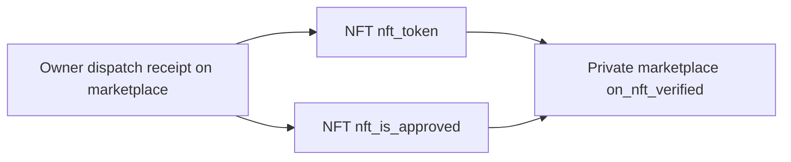

# Controlled local-node validation plan

**Current implementation status:** this document preserves the original
2026-11-02 plan. Subsequent tooling work and actual check results are recorded in
[the 2026-11-03 validation report](node-validation/reports/validation-20261103/REPORT.md).
The runner now exists, but all twenty node/TestLoop cases remain `NOT_RUN`.
The current user-authorized work includes disposable isolated local signers;
the historical authorization notes below do not supersede that authorization.

Prepared 2026-11-02. **Plan only: no node was started, no local or public deployment
was performed, and no transaction was signed or submitted.** The public manifest
and its approval flags remain unchanged. No contract or frontend changes are
required for the primary cases below. A node runner does not exist in this repo yet.

Machine-readable pins, local account aliases and planned case IDs are in
[local-node-validation.plan.json](public/local-node-validation.plan.json). This
file is a plan, not a deployment manifest or an execution permission.

## Recommendation and version pins

Use an isolated **NEAR Sandbox process built from nearcore 2.14.0-rc.5**, commit
`b7b4737cab46f17a6daa2ed694d7aebbd204363a`, running **protocol 88**. This matches the
node version/commit in the saved [public RPC snapshot](public/rpc-snapshot.json),
rather than silently substituting a library's default node version. The upstream
[release](https://github.com/near/nearcore/releases/tag/2.14.0-rc.5) and
[pinned workspace](https://github.com/near/nearcore/blob/b7b4737cab46f17a6daa2ed694d7aebbd204363a/Cargo.toml)
confirm the version. The source includes the official `neard --features sandbox`
build target in its [Makefile](https://github.com/near/nearcore/blob/b7b4737cab46f17a6daa2ed694d7aebbd204363a/Makefile).

| Component | Exact selection | Status |
| --- | --- | --- |
| Node | nearcore 2.14.0-rc.5, commit above, `sandbox` feature only | Source compatibility reviewed; not built/run here |
| Node build compiler | Rust 1.95.0, upstream [toolchain](https://github.com/near/nearcore/blob/b7b4737cab46f17a6daa2ed694d7aebbd204363a/rust-toolchain.toml) | Separate from contract compiler |
| Suggested runner libraries | `near-workspaces = "=0.24.0"`, `near-sandbox = "=0.4.0"` | Published source reviewed; isolated runner/lockfile still needed |
| RPC/schema dependencies | `near-jsonrpc-client = "=0.23.0"`, `near-primitives = "=0.38.0"`, `near-jsonrpc-primitives = "=0.38.0"` | Explicit compatible pins for the future runner |
| Approved contracts | Existing Rust 1.99.1 / SDK+standards 5.30.0 / near-sys 0.4.0 artifacts | Hashes/export allowlists reverified; do not rebuild for these tests |
| Optional scheduling tests | nearcore `test-loop-tests` at the same commit | Real runtime components with simulated network/clock; separate evidence class |

The [workspaces 0.24.0 manifest](https://github.com/near/near-workspaces-rs/blob/near-workspaces-v0.24.0/workspaces/Cargo.toml)
uses the 0.38 runtime schemas. Disable its default `install` feature and explicitly
pin the prebuilt node path. Sandbox 0.4.0's
[default is 2.14.0](https://github.com/near/near-sandbox-rs/blob/v0.4.0/src/lib.rs),
so a default `sandbox()` launch alone is insufficient version control. Its
[version/config launch API](https://github.com/near/near-sandbox-rs/blob/v0.4.0/src/sandbox/mod.rs)
supports the required explicit selection. Actual integration of these libraries
with the RC node still needs a compile and capability check; their version strings
alone are not a successful test.

This workspace is Linux x86_64. `near-sandbox`, `neard` and `docker` were not found
on PATH; no broader search of credential locations was performed. Required OS
build dependencies, disk/RAM capacity, the final binary SHA-256 and the runner
Cargo.lock remain unmeasured/uncreated. Source-build dependencies must follow the
pinned nearcore checkout; no binary download checksum is invented here.

An ordinary local `neard` from the same commit is an optional parity rerun after
the Sandbox suite. It must use the same private local genesis and isolation.
It cannot supply Sandbox patch/time RPCs. It is not a reason to connect to public
testnet, and no patch RPC is needed for the primary suite.

## Exact-artifact compatibility and isolation

Use these unchanged ordinary testnet files, mounted read-only in the future runner:

| Artifact | Repository-relative path | SHA-256 |
| --- | --- | --- |
| NFT, 484725 bytes | `contracts/nft/target/testnet/wasm32-unknown-unknown/release/near_nft_contract.wasm` | `b8a500297d6e93bc79c3f06834d09f31bf384816301d179d1aabb425a6a4a84d` |
| Marketplace, 696681 bytes | `contracts/marketplace/runtime/target/testnet/wasm32-unknown-unknown/release/near_marketplace_runtime_prototype.wasm` | `5f0b522306a87bc01beebe4c7575b8ae705785d38f003feae18eebfe2835708a` |

Both build scripts insist on Rust 1.99.1, reject compiler/flag overrides, and keep
ordinary testnet, production and test-hook outputs separate. Preserve all of this.
Do not enable `test-hooks`, substitute an instrumented NFT, strip Wasm sections,
or rebuild with the node's older compiler. The previous Wasm run demonstrates VM
loading at protocol 88, not full-node compatibility. The first real-node acceptance
step must verify imports/loading, initialization and `current_contract_code()`.

The NFT initializer, mint boundary and storage funding require `.testnet` suffixes.
Generic `.sandbox`/`.test.near` development names will fail those checks. Use local
genesis accounts with **different names from the funded public accounts**, retaining
the same UTF-8 lengths for storage comparison:

| Local-only account | Role | Initial local fixture balance |
| --- | --- | ---: |
| `local-nft-contract.testnet` | NFT | 10 NEAR |
| `local-market-contract.testnet` | Marketplace | 10 NEAR |
| `local-market-operator.testnet` | Seller/mint authority/admission owner/zero-fee fixture identity | 10 NEAR |

These are records on the isolated chain only, not account creation requests to
testnet. Add them as empty genesis accounts with fresh local public keys; this
bootstrap fixture is not evidence for normal account creation. The node validator
must be a separate account. Record observed account/key storage instead of assuming
the public snapshot's 182-byte baseline.

The artifact-domain byte remains `Testnet` (0), as required by the deployed Wasm.
The **network chain ID must be a unique local value**, e.g.
`nft-validation-local-<run-id>`, never `testnet` or `mainnet`. Discover and pin the
local genesis height/hash, and commit that local identity in a new local manifest.
The marketplace checks its own executing code hash and supplied domain; it does
not independently attest the chain genesis or NFT code. The runner must verify
both through the local node. A `.testnet` suffix is not proof of network identity.

Keep a separate `local-manifest.json` and a run envelope containing actual local
network/genesis identity, public local keys, artifact hashes, fixture terms, raw gas
and deposits, and an explicit local-only purpose. Do not edit
[the public template](public/manifest.template.json), set its review flags to true,
or monkeypatch `readiness.RPC`. Public readiness must continue rejecting local URLs.
Only the pure codecs and offline record-verification functions may be reused.

Before any future local write, require all of: loopback RPC address and resolved
socket, expected child process and binary hash, unique local chain/genesis pin,
non-public local account allowlist, approved Wasm hashes, and unchanged protocol
parameters. Reject redirects, external proxies, public account destinations, and
fallback RPC providers. Run node and runner in an egress-blocked container/VM or
network namespace with only the required local communication. No public RPC
access is necessary during the suite. Mount no wallet, CLI credential or user
keychain directories; do not use `near-cli` signing profiles.

**Key-handling boundary:** real transactions necessarily use signing material.
Any future execution needs separate authorization for the isolated test program
to generate/use disposable local signers and for the node's local validator
signing. The agent must not inspect/export/log them or read existing credentials.
Prefer in-memory account signers and node-owned ephemeral validator files, never
public-account credentials or a default credential loader. If the prohibition
also excludes a test process internally using newly generated local signing
material, transaction-level node execution cannot proceed; unsigned mocks are
not a substitute. Nothing in this plan authorizes that execution now.

## Reproducible procedure, after runner review and local-only authorization

1. **Freeze inputs.** Run `python3 -B contracts/testnet/readiness.py` and the Python
   regression suite. Hash the two existing Wasm files and save their export sets.
   Hash the public preparation inputs before/after the run to show they were not
   changed. Copy only public evidence and the read-only Wasm into the isolated
   test workspace. Record OS, node compiler, source commit, dependency lockfiles
   and runtime binary digest.

2. **Prepare the node binary outside the contract crates.** The following are
   proposed source-build commands, **not executed in this preparation**:

   ```sh
   git clone --no-checkout https://github.com/near/nearcore.git /tmp/nft-nearcore-validation
   git -C /tmp/nft-nearcore-validation checkout --detach b7b4737cab46f17a6daa2ed694d7aebbd204363a
   cd /tmp/nft-nearcore-validation
   cargo +1.95.0 build --locked --release -p neard --features sandbox
   sha256sum target/release/neard
   target/release/neard --version
   ```

   Use a fresh directory if that path exists. Install/download dependencies only
   during a separately reviewed build stage; then disable network egress for
   execution. Pin `NEAR_SANDBOX_BIN_PATH` to that verified binary, not `latest`.
   Never use `--unsafe-fast-startup`, a free-gas configuration or disabled storage
   charging to make a case pass.

3. **Generate one local chain per independent case.** Use Sandbox's genesis
   configuration API to add the empty accounts above, set protocol 88, assign a
   local chain ID, and retain normal genesis validation. Keep the node home
   outside this repository. Enable durable receipt/history capture and track all
   shards. Persist public genesis/config evidence separately from signer files.
   RPC must bind loopback; remove public boot nodes and telemetry destinations.
   Confirm actual launch behavior in the isolated process before proceeding.

4. **Preflight the running local environment.** Query `status`, genesis block,
   finalized header, `EXPERIMENTAL_protocol_config`, account/key/state views.
   Require protocol 88 and matching Wasm/host/action/storage parameters against
   [rpc-snapshot.json](public/rpc-snapshot.json). In particular verify storage
   cost 10^19 yoctoNEAR/byte, record overhead 40, minimum gas purchase price and
   returned-data/receipt limits. Preserve the runbook's stricter 300-Tgas call cap.
   Record allowable differences in chain ID, genesis, validator set and topology.
   Do not silently normalize a substantive runtime cost/feature difference.

5. **Complete a local fixture, not the public deployment manifest.** Preserve the
   candidate metadata/token ID and measurement-derived budgets/deposits, replace
   role and fee account names with the local aliases, and derive local policy and
   correlation commitments. These remain noncommercial test terms. Choose and
   record a finite local expiry using the local block timestamp plus an explicit
   test-window input. No U64-max expiry sentinel in this node suite. Every distinct
   immutable budget/result-bound/expiry case gets its own manifest and fresh chain.
   State clearly which values are fixture choices, node measurements or limits.

6. **Run the successful path using normal signed local transactions.**
   Self-sign NFT `[DeployContract(exact NFT bytes), FunctionCall(new_testnet)]`
   and marketplace `[DeployContract(exact market bytes),
   FunctionCall(bootstrap_with_admission_owner)]`, each as **one action batch**,
   initialization deposit zero. Deploying and initializing in two transactions
   does not test this requirement. Neither parent-account creation nor a helper
   contract may act as the initializer's predecessor/signer.

   A future Rust runner should construct the equivalent of
   `account.batch(account.id()).deploy(bytes).call(init_function)` with explicit
   gas/deposit. The pinned [transaction builder](https://github.com/near/near-workspaces-rs/blob/near-workspaces-v0.24.0/workspaces/src/operations.rs)
   supports ordered deployment and call actions. Check the serialized actions
   independently before submission; no auto-default gas or deployment helper
   that changes the signer/receiver/action ordering.

   Then, with finalized closure after every step: owner funding; authority
   self-mint; approval with `msg:null`; owner create admission; owner dispatch.
   Read the real numeric approval ID from finalized NFT state. Never seed a
   funded credit, pending operation or successful dependency into storage.
   Never manually call `on_nft_verified`; the node must produce and run it.

7. **Collect the complete graph and finalized state.** Retain the exact serialized
   local transaction hash before sending. Use `tx_status` (or its documented
   `EXPERIMENTAL_tx_status` alias) by hash/sender with `wait_until:"FINAL"`, then
   enumerate all outcome `receipt_ids` and receipt bodies. Check coverage yourself,
   including refunds. `FINAL` is necessary for accounting; the top-level result
   can still be successful when a detached callback failed. See the official
   [transaction RPC definitions](https://docs.near.org/api/rpc/transactions).

   A self-signed transaction's initial receipt may be absent from the `receipts`
   list. Anchor its outcome to the submitted transaction and use local block/
   chunk or node-store evidence for any missing body; fail evidence collection
   if it cannot be resolved. Do not fabricate a receipt from its expected shape.
   Preserve raw RPC responses rather than relying on a convenience result that
   discards receipt details. No indexer/Supabase projection is authoritative.

8. **Run the matrix below, reset by fresh case setup, then independently verify.**
   A failed case must not contaminate another. Node restart tests deliberately
   retain their own chain DB; other cases must not reuse successful nonces or
   modified manifests. Do not use `sandbox_patch_state` to erase failures. A node
   checkpoint, if used, must be taken while stopped/quiescent and identified by
   exact state/block/manifest hashes; never copy a live database casually.

9. **Issue a local evidence report.** For each case record `PASS`, `FAIL`,
   `INCONCLUSIVE` or `NOT_RUN`, expected and actual receipt outcomes, graph,
   finalized block hashes, code/state hashes, gas/storage/balance deltas, node
   fingerprint and environment differences. Review failures before accepting any
   new public-testnet budgets. Local success never flips public approval flags.

## Receipt and state assertions

The expected dispatch graph is:



The callback must carry exactly two input dependencies, token result first and
approval result second, mapped through actual receipt data IDs. Its predecessor
is marketplace, receiver marketplace, and attached value zero. Each NFT call
has marketplace predecessor, exact token/account/approval arguments and zero
deposit. All three child gas allocations come from the immutable operation.
The original signer may remain the operator; signer identity is not callback
authority. Compare dependencies, not the order of entries in an RPC response.

Sibling completion order is not an application guarantee. The pinned
[runtime receipt specification](https://github.com/near/nearcore/blob/b7b4737cab46f17a6daa2ed694d7aebbd204363a/docs/RuntimeSpec/Receipts.md)
describes waiting for all data dependencies, while the
[runtime implementation](https://github.com/near/nearcore/blob/b7b4737cab46f17a6daa2ed694d7aebbd204363a/runtime/runtime/src/lib.rs)
collects results by `input_data_ids`. A stock one-node success trace verifies its
observed schedule and dependency wiring, not every scheduling permutation.

Expected state sequence for generation 1: create => lifecycle Ready, listing
Verifying, reservation cursor 1; dispatch => lifecycle Dispatched, same pending
verification, cursor 2; successful callback => Completed/internal Active, cursor
3; failed/unacceptable NFT observation with successful callback => Completed/
Invalid, cursor 3. A callback that itself aborts leaves Dispatched/Verifying and
cursor 2. Commercial trading stays disabled in every state.

Receipt atomicity is not transaction-graph atomicity. A failed action receipt
rolls back its action-state changes, including code deployment in that batch and
uncommitted promises. Earlier successful receipts, gas charges and signer nonce
consumption are not undone. Protocol refund processing is separate. Also, runtime
bookkeeping may consume callback inputs when a callback fails: do not interpret
application rollback as automatic callback retry. These expectations follow the
pinned runtime's commit/rollback and input-consumption boundaries, and must be
confirmed by each node trace.

## Coverage matrix and exact case recipes

**No row below has been run on a real node.** Existing evidence is source review,
native mocks and the local Wasm harness described in
[PREPARATION.md](public/PREPARATION.md). `S` means a planned standalone Sandbox
process test; `L` means a supplemental nearcore runtime test with simulated
delivery/clock, not standalone-node evidence.

| ID | Environment and stimulus | Evidence required to claim a pass | Boundary |
| --- | --- | --- | --- |
| S01 | Exact-artifact loading and successful two-action self-deploy/init for both contracts | Code SHA equals approved bytes; all bindings/root/authority records match local manifest; one batch each; zero init deposits | Full-node compatibility still NOT_RUN |
| S02 | Same batches with invalid initializer metadata/domain/owner arguments | Actual init Failure, code remains absent, no root/sidecars; fees/nonce accounted | Establish exact two-action rollback on initializer rejection |
| S03 | Two-action initialization with calibrated storage underfunding or initializer OOG | Receipt accepted and failed during execution, code/root/sidecars absent | A transaction rejected before execution does not cover this row; prove failure phase |
| S04 | Supplemental `[Deploy, valid Init, repeated Init]` batch on a fresh account | Last action fails on already-initialized check; earlier successful initialization and deployment both rolled back | Three-action batch, explicitly additional to S02/S03 |
| S05 | Fund, mint and approve at node-measured storage minimum; separate fresh cases at minimum minus one yocto | Success at boundary; underfunded receipt Failure restores every application key/value, enumeration/counter and owner-credit field; protocol refunds close | Use enough gas; distinguish storage failure from OOG |
| S06 | Create with `creation_bytes = B-1` after node calibration of actual B; reserve >= declared bytes cost and fund sufficiently | Post-write growth check fails; no admission/lifecycle/guard/listing/slot/watermark/operation/reservation survives; generation/account credits unchanged | Strong ordinary-artifact post-write rollback case |
| S07 | Baseline create/dispatch/verification | Two actual NFT calls and one actual private callback; data-ID order; Completed/Active, cursor 3, exact conservation, unchanged ownership | Existing VM manually supplies results; only this node trace closes that gap |
| S08 | Give first NFT call one raw gas unit; then second alone; then both, in separate immutable fixtures | Child execution Failure(s), authentic callback sees failed dependencies and completes Invalid; parent dispatch remains committed | Positive one-gas values pass codec; capture actual OOG/loading error |
| S09 | Give callback one raw gas unit; also sweep to a later callback OOG boundary | NFT calls succeed, callback Failure; application remains Dispatched/Verifying/cursor 2; duplicate dispatch creates no new NFT graph; release rejected | Permanent application pending after known callback failure; no recovery claim |
| S10 | Sweep transaction gas for mint/fund/approve/create/dispatch from measured success down to failure | Classify preflight rejection vs runtime OOG; compare full state and emitted children after every receipt | Dispatch guard rejection alone is not proof of post-write OOG rollback; mark unobserved phases INCONCLUSIVE |
| S11 | Measure actual `nft_token` result length N; fresh cases with max_result_bytes N-1, N, N+1 and valid lower bound 5 | Authentic NFT result exceeds only N-1/5 bounds; successful callback returns Invalid there and Active at N/N+1; no allocation on callback | Exact NFT supports this without malicious helper code; N must be 5..16383 for all three tests |
| S12 | Revoke approval after create, wait for revoke finality, then dispatch existing admission | NFT returns real stale approval observation; callback Invalid, ownership unchanged, reservations conserved | Runner's success-stage precheck must not prevent this deliberately invalid local fixture; contract checks remain unchanged |
| S13 | Replay successful funding nonce with an attached deposit; exact create retry; pending dispatch retry | Duplicate funding fails/refunds without new credit; create idempotent; pending dispatch returns existing status without another graph | Retries are controlled experiments, not production retry guidance |
| S14 | Ready-only release; then rejected dispatch; release attempted after callback OOG/completion | Ready release changes only permitted fixed-width records/credit attribution; dispatched/completed allocations never released | No native withdrawal or external payout is added |
| S15 | RPC proxy forwards one local funding/dispatch submission, drops response; separate case drops before forwarding | Client records UNKNOWN, queries same hash/sender and raw state; never automatically re-signs or chooses a new funding nonce; later outcome reconciles once | RPC uncertainty is different from missing on-chain execution |
| S16 | Pause/stop local node around dispatch, restart its same DB, retain collector journal | If a pending receipt checkpoint is actually captured, queued graph resumes once; otherwise report only process restart coverage | Timing a stop does not prove a callback was pending; lost RPC response is not lost receipt |
| S17 | Successful exact/excess deposits, after all protocol and application refund receipts finalize | Per-account balance reconciliation, actual refunds, measured storage and burned gas | Excess = measured minimum + 2 yocto tests the NFT's refund >1 branch; +1 has different behavior |
| L01 | Four local simulated validators, >=2 shards, distinct NFT/market placement; delay one shard's chunks after committed dispatch, then resume | Actual node-component stores show pending dependency, no terminal application state before delivery, eventual authentic callback | Simulated network/clock; preserve valid protocol rules, record custom topology |
| L02 | Same delayed execution crosses a finite local expiry, then delivery resumes | Callback uses actual advanced timestamp and completes Invalid; no manual result insertion | Test elapsed timestamp, not merely skipped block height |
| L03 | Reviewed delivery adapter schedules captured genuine dependencies in alternate arrival orders / withholds one | Runtime waits for missing dependency; callback result mapping stays canonical after delivery | No stock Sandbox per-receipt drop RPC established; adapter feasibility/implementation remains pending |
| LIMIT | Malformed JSON, duplicate object keys, >5-byte boolean response, forged callback count, arbitrary permanent receipt loss | No exact-artifact node claim | Pinned NFT cannot emit these ABI violations normally; current mocks cover some parser cases only |

For S05, previous VM candidates are mint 0.00929 NEAR, approval 0.00188 NEAR and
funding metadata 0.00618 NEAR, with 3280 bytes of creation growth. These are starting
hypotheses, not real-node minima. Obtain B and deposits from a fresh successful
node calibration first; retain full integer units in the evidence. `funding`
amount must additionally cover the selected usable reservation. Wrong deposits
must not accidentally become insufficient transaction-balance tests.

Gas sweeps must be adaptive and recorded: halve a passing budget until failure,
then bisect that bracket with fresh deterministic setup for each trial, preserving
the 300-Tgas cap. Do not assume monotonicity without checking identical contexts.
Separate contract burn, receipt/action overhead, child prepaid gas and returned
unused gas. Instrumenting the contract to prove an internal instruction location
would invalidate its approved hash; if an uninstrumented trace cannot prove
post-write OOG, retain that coverage gap. Deterministic post-write storage failures
(S05/S06) still establish useful rollback coverage without that claim.

The official [TestLoop guide](https://github.com/near/nearcore/blob/b7b4737cab46f17a6daa2ed694d7aebbd204363a/test-loop-tests/README.md)
supports topology, protocol selection, runtime queries and node restart. Its
[drop conditions](https://github.com/near/nearcore/blob/b7b4737cab46f17a6daa2ed694d7aebbd204363a/test-loop-tests/src/setup/drop_condition.rs)
control chunks/endorsements/blocks; they do not establish a ready-made arbitrary
DataReceipt editor. The two NFT calls share a receiver, so even a multi-shard
setup does not automatically provide every sibling ordering. A delivery adapter
must preserve genuine receipt payloads and IDs, never replace them with `true` or
synthetic successful results. Do not copy the upstream delayed-receipt example's
gas-burning helper contract into the exact-artifact acceptance suite.

## Independent state, storage and balance verification

After each terminal graph, choose one finalized block at or after all relevant
receipts. Query every account/state/view at that exact block hash; reject mixed
block results. Preserve account balance, locked amount, code hash, storage usage,
public keys/nonces, NFT token/enumeration/approval/authority views and the complete
bounded raw contract-state map. Where multiple RPC pages/prefixes are needed,
maintain the same block and prove collection completeness.

Use an independent Python verifier over saved raw evidence, without RPC signing
capability. Reuse the frozen Borsh/domain/envelope checksum rules from `flow.py`
and the independent codec vectors. Its current `verify_records` checks only the
successful Completed/Active outcome; a separate verifier must add exact Ready,
Dispatched, Invalid and Released expectations and full rollback snapshots. Never
weaken `verify_records` to accept pending as success. Cross-check decoded values
with local-node views and, where necessary, read-only stopped-node store evidence.
Two decoders improve independence of implementation, not consensus trust.

At each storage mutation, compare account `storage_usage` deltas with raw key/value
changes plus the protocol's 40-byte new-record overhead, including SDK `STATE`,
authority/metadata, counters, mutation/permanent-ID sidecars and accounting roots.
Separate code bytes and pre-existing account/key storage. Compare the measured
deposit charge and available/reserved/staked attribution against this growth.
Check dispatch/callback grow by zero and preserve exact reservation conservation.
For longer token IDs/metadata, run distinct calibrated fixtures; do not generalize
the single-token candidate deposit to all mint calls or future transfers.

For balances, wait through both application refund transfers and protocol gas/
failed-deposit refunds. Deduplicate outcomes by ID; sum actual `tokens_burnt`,
not guessed `gas_burnt * current block price`. Track signer escrow/nonce changes
and each refund beneficiary. On the protocol-88 zero-gas-reward configuration,
with all transfers/refunds internal to the three non-validator local accounts,
their aggregate balance drop should equal unique transaction-plus-receipt burns.
If a beneficiary or reward is external, explicitly include that flow in the
equation. Storage stake restricts spendable balance; it is not an additional burn.
Do not double-count prepaid child gas as both parent and child burn.

Archive run manifest/config digests; exact Wasm digests; public transaction bodies
and hashes; all outcome/receipt/data-dependency evidence; per-stage finalized
snapshots; result byte lengths; gas metadata; actual refunds; verifier report;
observed graph closure; and an explicit local-only evidence label. No signer
files, environment dumps or private material belong in this archive. A proof
rooted in a local genesis proves that local execution, not public-network trust.

## Required tooling changes — proposed, not implemented

| Item | Separate work required | Safeguard |
| --- | --- | --- |
| T1 | Standalone `contracts/testnet/node-validation/` runner crate with exact library pins and reviewed Cargo.lock | No changes to either contract Cargo.toml/lockfile/build scripts; disable automatic node installation |
| T2 | Isolated node launcher, genesis fixture builder, public environment fingerprint and per-write local-only guard | No credential loader, public RPC fallback, public account targets or generic CLI send path |
| T3 | Local-only manifest/operation builder; explicit success and negative-case action specifications | Reuse pure codecs; leave public readiness/manifest blocked and unchanged |
| T4 | Submission journal, raw graph collector, finalized-block snapshots and timeout proxy | Compute/save hash before send; submit once; no hidden retry that refreshes nonce/block hash |
| T5 | Offline state/receipt/balance verifier for every matrix terminal/pending state | Pending/unknown stays pending/unknown; graph completeness required for accounting |
| T6 | Deterministic case setup and measured storage/gas boundary search | Exact ordinary Wasm; no contract-state patching, host-result injection or relaxed limits |
| T7 | Optional test-only additions in an isolated pinned nearcore checkout for L01–L03 | Label simulated transport; no production runtime or contract logic changes; receipt adapter requires review |

The current `measure_local.py` directly executes Wasm in `MockedExternal` and
manually populates callback promise results. Keep it as an offline comparator; do
not rename its reports to “node validation.” `snapshot.py` is deliberately pinned
to public testnet and remains read-only. It must not be repurposed as this launcher.

No executable command for the not-yet-written runner is advertised as working.
The numbered procedure, immutable source pins and case recipes are the implementation
specification. After T1–T6 exist, the runner must expose an explicit local-only
opt-in; compile-only/lint checks must not start a node or deploy contracts.

## Remaining limits and acceptance decision

Local tests can establish action-receipt rollback and observed graph/state/balance
behavior under the recorded runtime. They cannot establish public key custody,
public genesis trust, public RPC honesty/availability, live congestion/gas-price
distribution, all shard layouts/resharding, validator diversity, adversarial
consensus, future upgrades or indefinite liveness. Process Sandbox and TestLoop
have different failure surfaces; record both and do not merge their claims.

Stock node RPC does not provide an established control to permanently erase one
authentic callback while preserving a healthy chain. A network outage is normally
delay, not proof of loss. Callback OOG is a known receipt failure but still leaves
application state pending. This version has no timeout/recovery/resend or release
path for that dispatched reservation. A successful local test demonstrates this
limitation; it does not fix it or authorize recovery.

Malformed/forged dependency payloads require either existing mocks or a separately
approved adversarial fixture/runtime harness. Such evidence must never be described
as the exact two approved contracts executing their ordinary public ABI together.
Trading, purchases, withdrawals, public approval intake and transfers stay outside
this suite; future commercial/purchase/transfer safety is not validated here.

Before any public deployment, independently review the complete local evidence,
resolve FAIL/INCONCLUSIVE cases, assess the pending-reservation limitation, remeasure
the final approved fixture/budgets where needed, and separately complete all human
decisions in [the preparation report](public/PREPARATION.md). A changed public
protocol/node version requires compatibility review and relevant reruns.

Current checks performed for this plan: approved Wasm hashes and export sets pass
readiness; 12 Python regressions pass; pinned official source/release/API review is
complete. **Real-node results: none. Node starts: zero. Deployments: zero.**
